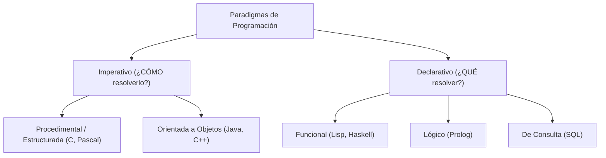
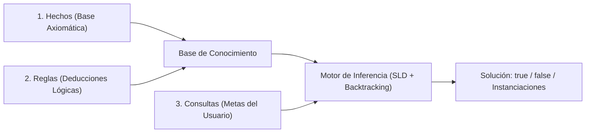

# Guía Definitiva de Estudio: Paradigmas Funcional y Lógico
## Common Lisp y Prolog (Teoría, Sintaxis y Prácticas de Laboratorio)

---

## Tabla de Contenidos
1. [Bloque I: Fundamentos Teóricos de los Paradigmas Declarativos](#bloque-i-fundamentos-teóricos-de-los-paradigmas-declarativos)
   - 1.1 [Imperativo vs Declarativo: Taxonomía y Enfoque](#11-imperativo-vs-declarativo-taxonomía-y-enfoque)
   - 1.2 [Fundamentos Matemáticos del Paradigma Funcional](#12-fundamentos-matemáticos-del-paradigma-funcional)
   - 1.3 [El Cálculo Lambda ($\lambda$) y Reducciones](#13-el-cálculo-lambda-lambda-y-reducciones)
   - 1.4 [Notaciones de Expresiones y Semántica vs Sintaxis](#14-notaciones-de-expresiones-y-semántica-vs-sintaxis)
   - 1.5 [Fundamentos de la Programación Lógica y Cláusulas de Horn](#15-fundamentos-de-la-programación-lógica-y-cláusulas-de-horn)
2. [Bloque II: Common Lisp (Paradigma Funcional y Simbólico)](#bloque-ii-common-lisp-paradigma-funcional-y-simbólico)
   - 2.1 [Historia, Filosofía y Homoiconicidad](#21-historia-filosofía-y-homoiconicidad)
   - 2.2 [S-Expressions y Regla de Oro de Evaluación](#22-s-expressions-y-regla-de-oro-de-evaluación)
   - 2.3 [Tipos de Datos Primitivos, Notación y Comentarios](#23-tipos-de-datos-primitivos-notación-y-comentarios)
   - 2.4 [Operadores Aritméticos, Lógicos y Predicados de Igualdad](#24-operadores-aritméticos-lógicos-y-predicados-de-igualdad)
   - 2.5 [Variables y Ámbitos: `defparameter`, `defvar`, `setq`, `setf` y `let`](#25-variables-y-ámbitos-defparameter-defvar-setq-setf-y-let)
   - 2.6 [Definición de Funciones (`defun`), Parámetros y Docstrings](#26-definición-de-funciones-defun-parámetros-y-docstrings)
   - 2.7 [Entrada y Salida: Salida Formateada con `format`](#27-entrada-y-salida-salida-formateada-con-format)
   - 2.8 [Estructuras de Control Condicional: `if`, `when`, `unless`, `cond`, `case`](#28-estructuras-de-control-condicional-if-when-unless-cond-case)
   - 2.9 [El Corazón de Lisp: Listas y Celdas Cons](#29-el-corazón-de-lisp-listas-y-celdas-cons)
   - 2.10 [Recursión en Lisp y Patrones de Recorrido](#210-recursión-en-lisp-y-patrones-de-recorrido)
   - 2.11 [Iteración Pragmática: `dotimes`, `dolist` y `loop`](#211-iteración-pragmática-dotimes-dolist-y-loop)
   - 2.12 [Desglose y Análisis Exhaustivo de las Prácticas de Lisp](#212-desglose-y-análisis-exhaustivo-de-las-prácticas-de-lisp)
3. [Bloque III: Prolog (Paradigma Lógico y Declarativo)](#bloque-iii-prolog-paradigma-lógico-y-declarativo)
   - 3.1 [Historia, Filosofía y Declaratividad Pura](#31-historia-filosofía-y-declaratividad-pura)
   - 3.2 [Sintaxis y Tipos de Términos](#32-sintaxis-y-tipos-de-términos)
   - 3.3 [Los Tres Pilares: Hechos, Reglas y Consultas](#33-los-tres-pilares-hechos-reglas-y-consultas)
   - 3.4 [Motor de Inferencia: Unificación y Backtracking](#34-motor-de-inferencia-unificación-y-backtracking)
   - 3.5 [Aritmética en Prolog: La Regla de Oro de `is`](#35-aritmética-en-prolog-la-regla-de-oro-de-is)
   - 3.6 [Listas en Prolog: Notación `[Cabeza|Cola]` y Patrones](#36-listas-en-prolog-notación-cabezacola-y-patrones)
   - 3.7 [Recursión en Prolog: Casos Base y Casos Recursivos](#37-recursión-en-prolog-casos-base-y-casos-recursivos)
   - 3.8 [Control de Búsqueda: El Operador de Corte (`!`) y Negación (`\+`)](#38-control-de-búsqueda-el-operador-de-corte--y-negación-)
   - 3.9 [Entrada y Salida en SWI-Prolog](#39-entrada-y-salida-en-swi-prolog)
   - 3.10 [Flujo de Trabajo y Comandos en SWI-Prolog (`swipl`)](#310-flujo-de-trabajo-y-comandos-en-swi-prolog-swipl)
   - 3.11 [Desglose y Análisis Exhaustivo de las Prácticas de Prolog](#311-desglose-y-análisis-exhaustivo-de-las-prácticas-de-prolog)
4. [Bloque IV: Gran Comparativa: Common Lisp vs Prolog](#bloque-iv-gran-comparativa-common-lisp-vs-prolog)
   - 4.1 [Tabla Comparativa Multidimensional](#41-tabla-comparativa-multidimensional)
   - 4.2 [Problemas Equivalentes Resueltos en Ambos Lenguajes](#42-problemas-equivalentes-resueltos-en-ambos-lenguajes)
5. [Bloque V: Banco de Preguntas Típicas y Trampas de Examen](#bloque-v-banco-de-preguntas-típicas-y-trampas-de-examen)

---

# Bloque I: Fundamentos Teóricos de los Paradigmas Declarativos

## 1.1 Imperativo vs Declarativo: Taxonomía y Enfoque

Un **paradigma de programación** define el conjunto de conceptos, principios y métodos que determinan cómo un programador estructura, concibe y ejecuta la solución a un problema computacional.



### Tabla Comparativa de Paradigmas Fundamentales

| Característica | Paradigma Imperativo | Paradigma Declarativo (Funcional / Lógico) |
| :--- | :--- | :--- |
| **Pregunta central** | **¿Cómo** debe resolverse el problema paso a paso? | **¿Qué** relaciones o propiedades describen la solución? |
| **Control de Estado** | Estado mutable. Las variables cambian de valor en memoria en cada paso ($x \leftarrow x + 1$). | Estado inmutable o unificación lógica. No hay reasignación destructiva. |
| **Flujo de Ejecución** | Secuencias de instrucciones, bucles explícitos (`for`, `while`) y saltos condicionales. | Evaluación de expresiones matemáticas puras o deducción lógica mediante inferencia. |
| **Herramienta principal** | Algoritmos paso a paso, procedimientos y métodos que mutan estructuras. | Composición de funciones, recursión, unificación y reglas de inferencia. |
| **Analogía** | Una receta de cocina con instrucciones secuenciales detalladas. | El menú de un restaurante o una especificación matemática de axiomas y teoremas. |

### Clasificación General de Lenguajes
* **Por Nivel de Abstracción:**
  * *Bajo Nivel:* Código máquina (binario) y Ensamblador (mnemónicos directos al hardware).
  * *Nivel Medio:* Lenguajes como `C` que ofrecen abstracciones estructuradas pero manipulan punteros y direcciones de memoria directamente.
  * *Alto Nivel:* Lenguajes abstractos, independientes del hardware (`Lisp`, `Prolog`, `Python`), donde el programador se desentiende de la gestión de registros del procesador.
* **Por Generación:**
  * **1GL / 2GL:** Binario y Ensamblador.
  * **3GL:** Lenguajes estructurados de alto nivel (`C`, `Pascal`, `Fortran`).
  * **4GL:** Lenguajes enfocados en dominios específicos de gestión de datos (`SQL`).
  * **5GL:** Lenguajes orientados a Inteligencia Artificial, procesamiento simbólico y sistemas basados en conocimiento (`Lisp`, `Prolog`).

---

## 1.2 Fundamentos Matemáticos del Paradigma Funcional

El paradigma funcional modela la computación como la evaluación de **funciones matemáticas puras**, evitando la mutabilidad y los efectos secundarios (*side-effects*).

$$\text{Entrada} \xrightarrow{\quad f \quad} \text{Salida}$$

### 1. Conceptos Clave de las Funciones Matemáticas
* **Dominio ($\text{Dom}(f)$):** Conjunto total de valores de entrada posibles que la función está capacitada para recibir.
* **Contradominio o Codominio ($\text{Cod}(f)$):** Conjunto total de posibles valores de salida que la función puede producir.
* **Rango o Imagen:** Subconjunto del codominio formado por los valores efectivamente alcanzados por la función: $\text{Im}(f) = \{f(x) \mid x \in \text{Dom}(f)\}$.
* **Composición de Funciones:** Mecanismo algebraico de enlazar la salida de una función como la entrada de la siguiente:
  $$(f \circ g)(x) = f(g(x))$$

### 2. Principios Inquebrantables de la Programación Funcional
1. **Transparencia Referencial (Determinismo):** Una expresión puede ser sustituida por su valor calculado en cualquier punto del programa sin alterar su comportamiento. Si $f(4) = 8$, cada aparición de $f(4)$ puede reemplazarse por $8$. La función depende **únicamente** de sus parámetros de entrada, nunca del tiempo, reloj, variables globales o estado de red.
2. **Inmutabilidad:** Las variables en el paradigma funcional puro no son cajas de memoria que se sobrescriben; son **ligaduras simbólicas** (*bindings*) a valores. Una vez asociada, una variable es constante.
3. **Ausencia de Efectos Secundarios (*No Side Effects*):** Una función pura no modifica variables fuera de su entorno local, no altera argumentos pasados por referencia, no escribe en disco ni modifica pantallas como parte de su cálculo lógico.
4. **Recursión como Sustituto de Bucles:** Al no existir variables contadoras mutables ($i++$), las repeticiones se realizan de forma natural mediante funciones que se invocan a sí mismas reduciendo el tamaño del problema hasta un **caso base**.
5. **Funciones de Primera Clase (*First-Class Citizens*):** Las funciones tienen la misma jerarquía que cualquier valor básico (como un entero o una cadena). Se pueden:
   - Almacenar en variables o estructuras de datos.
   - Pasar como argumentos a otras funciones.
   - Retornar como resultado de otras funciones (**Funciones de Orden Superior / *Higher-Order Functions***).

---

## 1.3 El Cálculo Lambda ($\lambda$) y Reducciones

Creado por **Alonzo Church** en la década de 1930, el **Cálculo Lambda** es el sistema formal matemático que modela la definición, aplicación y computación de funciones. Es el fundamento teórico directo de todos los lenguajes funcionales.

### Operaciones Nucleares del Cálculo Lambda
1. **Abstracción Lambda (Creación de Funciones Anónimas):**
   $$\lambda x . M$$
   Donde $x$ es el parámetro formal vinculado y $M$ es el cuerpo o expresión que define la función.
2. **Aplicación Lambda (Invocación):**
   $$M \; N$$
   Aplica la función $M$ sobre el argumento de entrada $N$.

### Reglas de Transformación y Reducción
* **Conversión Alfa ($\alpha$-conversión):** Renombra variables vinculadas para evitar colisiones o ambigüedades de nombres (*variable shadowing/capture*). No altera la semántica de la función.
  $$\lambda x . x \;\equiv_\alpha\; \lambda y . y$$
  *Ejemplo con funciones anidadas:*
  $$(\lambda x . (\lambda x . x)) \; z \;\xrightarrow{\alpha}\; (\lambda x . (\lambda y . y)) \; z$$
* **Reducción Beta ($\beta$-reducción):** Es el acto formal del cálculo o sustitución. Reemplaza cada aparición del parámetro ligado en el cuerpo de la función por el argumento suministrado.
  $$(\lambda x . \text{expr}) \; A \;\xrightarrow{\beta}\; \text{expr}[x \mapsto A]$$
  *Ejemplo 1:*
  $$(\lambda x . * \; 2 \; x) \; 4 \;\xrightarrow{\beta}\; (* \; 2 \; 4) = 8$$
  *Ejemplo 2 (con Currificación / Currying):*
  $$(\lambda x . \lambda y . + \; x \; y) \; 4 \; 3 \;\xrightarrow{\beta}\; (\lambda y . + \; 4 \; y) \; 3 \;\xrightarrow{\beta}\; (+ \; 4 \; 3) = 7$$

---

## 1.4 Notaciones de Expresiones y Semántica vs Sintaxis

### Notaciones Aritméticas
* **Infija (Infix):** El operador se sitúa **entre** los operandos: $A + B$. Requiere reglas de precedencia de operadores y paréntesis para eliminar ambigüedades: $(2 + 3) \times 4$.
* **Prefija (Prefix / Notación Polaca):** El operador precede a sus operandos: $+ \; A \; B$. Es la notación utilizada por el Cálculo Lambda y por **Lisp**: `(+ 2 3)`. Elimina por completo la ambigüedad y permite aridad variable de forma natural: `(+ 1 2 3 4 5)`.
* **Postfija (Postfix / Notación Polaca Inversa - RPN):** El operador va después de sus operandos: $A \; B \; +$. Muy eficiente para procesadores basados en pila (*stack machines*).

### Sintaxis vs Semántica
* **Sintaxis:** El conjunto de reglas gramaticales y léxicas que dictan cómo deben construirse las cadenas de texto de un programa válido (paréntesis, comas, palabras clave). Si la sintaxis se viola, el compilador o intérprete emite un error de análisis (*parsing error*).
* **Semántica:** El significado e interpretación lógica de las construcciones sintácticas. Define qué realiza la instrucción en tiempo de ejecución.
  > Dos programas pueden tener sintaxis radicalmente diferente pero idéntica semántica (por ejemplo, el cálculo del factorial en Lisp mediante recursión de cola y en C con un bucle `while`).

---

## 1.5 Fundamentos de la Programación Lógica y Cláusulas de Horn

La programación lógica se basa en la **lógica de predicados de primer orden**. En lugar de describir algoritmos mediante transformaciones de datos, un programa lógico describe axiomas de un dominio formal.

* **Robert Kowalski** demostró en 1974 que la lógica formal puede utilizarse como lenguaje de programación computacional basándose en la ecuación de Kowalski:
  $$\text{Algoritmo} = \text{Lógica} + \text{Control}$$
  *Donde la **Lógica** la define el programador (hechos y reglas) y el **Control** lo aporta el motor de inferencia.*
* **Cláusula de Horn:** Es una cláusula lógica que contiene **como máximo un literal positivo (afirmado)**:
  $$A \lor \neg B_1 \lor \neg B_2 \lor \dots \lor \neg B_n$$
  Que formalmente es equivalente a la implicación lógica:
  $$(B_1 \land B_2 \land \dots \land B_n) \implies A$$
  En sintaxis de programación lógica (Prolog), esta implicación se invierte por conveniencia de resolución a la forma de regla:
  $$A \impliedby (B_1 \land B_2 \land \dots \land B_n) \quad\equiv\quad \texttt{A :- B1, B2, ..., Bn.}$$
* **Hipótesis del Mundo Cerrado (*Closed World Assumption* - CWA):** Principio fundamental que estipula que **todo lo que no pueda deducirse como verdadero a partir de la base de conocimiento se considera categóricamente falso**.

---

# Bloque II: Common Lisp (Paradigma Funcional y Simbólico)

## 2.1 Historia, Filosofía y Homoiconicidad

Creado en **1958** por **John McCarthy** en el MIT, LISP (*LISt Processing*) es el segundo lenguaje de alto nivel más antiguo de la historia de la computación (solo después de Fortran) y el pionero indiscutible de la Inteligencia Artificial simbólica.

### Hitos Históricos de Lisp:
* Introdujo la estructura de datos en **árbol binario** mediante listas enlazadas.
* Creó el primer sistema automático de **recolección de basura (*Garbage Collector*)**.
* Popularizó las variables de tipado dinámico y las funciones de primera clase.
* **Common Lisp (ANSI Standard, 1994):** Estandarización unificada que combina las variantes Maclisp, ZetaLisp e Interlisp, proveyendo un entorno multiparadigma maduro y de alto rendimiento.

### Homoiconicidad ("Code is Data, Data is Code")
En Lisp, el código fuente del programa se escribe **exactamente en la misma estructura de datos fundamental que el programa procesa: listas anidadas**.
* Una lista como `(+ 2 3)` puede ser tratada como una **instrucción de código** que devuelve `5`, o como una **secuencia de tres elementos de datos** si se le antepone una comilla: `'(+ 2 3)`.
* Esto permite la meta-programación más potente existente en la informática a través del sistema de **macros**, donde un programa en Lisp puede generar, modificar y ejecutar nuevo código Lisp en tiempo de compilación.

---

## 2.2 S-Expressions y Regla de Oro de Evaluación

Todo el lenguaje se compone exclusivamente de **S-expressions** (Expresiones Simbólicas):

```
S-Expression
 ├── Átomo (indivisible)
 │    ├── Número: 42, 3.1416, 2/3
 │    ├── Símbolo: x, nombre, foo, *directorio*
 │    └── Cadena (String): "Hola Mundo"
 └── Lista (secuencia encerrada entre paréntesis)
      └── (elemento-1 elemento-2 ... elemento-N)
```

> [!IMPORTANT]
> ### Regla de Oro de Evaluación en Lisp
> Cuando el intérprete de Lisp se encuentra con una lista `(F A1 A2 ... An)` sin comilla:
> 1. Evalúa el primer elemento `F` como el **nombre de una función, macro o forma especial**.
> 2. Evalúa recursivamente de izquierda a derecha cada uno de los argumentos `A1, A2, ..., An`.
> 3. Aplica la función `F` a los valores obtenidos de los argumentos y retorna el resultado.

Si se desea evitar que una lista sea evaluada como llamada a función, se "cita" mediante el operador `quote` o su abreviatura con comilla simple `'`:
```lisp
(+ 1 2)   ; Se evalúa como función -> Devuelve: 3
'(+ 1 2)  ; Se toma como dato literal -> Devuelve la lista: (+ 1 2)
```

---

## 2.3 Tipos de Datos Primitivos, Notación y Comentarios

### Tipos de Datos
1. **Números:**
   * Enteros de precisión arbitraria (*bignums* automáticos): `42`, `-100`, `1000000000000000000000`.
   * Fracciones exactas (Racionales): `2/3`, `9/5`. Si se dividen enteros que no dan división exacta, Lisp preserva la fracción matemática: `(/ 4 6)` $\rightarrow$ `2/3`.
   * Flotantes: `3.1416`, `0.0`, `1.5e-3`.
   * Complejos: `#C(2 3)` ($2 + 3i$).
2. **Símbolos:**
   * Identificadores léxicos: `agua`, `papel`, `persona`.
   * Son *case-insensitive* por defecto (Lisp los convierte internamente a mayúsculas: `agua` $\rightarrow$ `AGUA`).
3. **Cadenas de caracteres (Strings):**
   * Delimitadas por comillas dobles: `"Reforma 222"`.
4. **Booleanos y Lista Vacía:**
   * `t`: Representa la constante lógica **Verdadero** (*True*).
   * `nil`: Representa simultáneamente **Falso** (*False*) y la **Lista Vacía** `()`.
   * En Common Lisp: `(eq nil '())` es `t`.

### Niveles de Comentarios por Convención Estilística
```lisp
;;;; Cuatro puntos y coma: Título del archivo o encabezado general de un módulo
;;; Tres puntos y coma: Descripción de una sección importante o grupo de funciones
;; Dos puntos y coma: Explicación de un bloque de código o dentro de una función
; Un solo punto y coma: Comentario breve al final de una línea de código
```

---

## 2.4 Operadores Aritméticos, Lógicos y Predicados de Igualdad

### Operaciones Aritméticas (Notación Prefija)
```lisp
(+ 10 5)           ; 15
(- 10 5)           ; 5
(* 10 5)           ; 50
(/ 10 5)           ; 2
(/ 9 5)            ; 9/5 (resultado racional exacto)
(/ 9.0 5.0)        ; 1.8 (resultado flotante)
(+ 1 2 3 4 5)      ; 15 (admite múltiples argumentos)
(* 2 (+ 3 4))      ; 14 (evaluación anidada: 2 * (3 + 4))
```

### Operadores Relacionales y Lógicos
* Numéricos: `(= 5 5)` $\rightarrow$ `t`, `(< 3 5)` $\rightarrow$ `t`, `(> 3 5)` $\rightarrow$ `nil`, `(<= 4 4)` $\rightarrow$ `t`, `(>= 10 2)` $\rightarrow$ `t`.
* Lógicos:
  ```lisp
  (and t t nil)      ; nil (evaluación en cortocircuito)
  (or nil t nil)     ; t
  (not t)            ; nil
  (not nil)          ; t
  ```

### Jerarquía de Predicados de Igualdad en Common Lisp
Common Lisp posee cuatro funciones de igualdad con propósitos estrictamente diferenciados:

| Predicado | Nivel de Comparación | Cuándo Utilizarlo | Ejemplo |
| :--- | :--- | :--- | :--- |
| **`eq`** | Identidad de puntero en memoria física. | **Símbolos** atómicos exclusivamente (`'nombre`, `'agua`). | `(eq 'a 'a)` $\rightarrow$ `t` |
| **`eql`** | Como `eq`, pero además compara números del mismo tipo numérico y caracteres. | Comparar símbolos, números o caracteres individuales. Es el comparador por defecto en Lisp. | `(eql 3 3)` $\rightarrow$ `t`<br>`(eql 3 3.0)` $\rightarrow$ `nil` |
| **`equal`** | Igualdad estructural profunda (recorre elementos equivalentes). | Comparar **listas**, arreglos o **cadenas de texto** (`strings`). | `(equal "hola" "hola")` $\rightarrow$ `t`<br>`(equal '(1 2) '(1 2))` $\rightarrow$ `t` |
| **`=`** | Igualdad aritmética pura. | Comparar **únicamente números**, admitiendo conversiones entre enteros, fracciones y flotantes. | `(= 3 3.0)` $\rightarrow$ `t`<br>`(= 2/4 0.5)` $\rightarrow$ `t` |

---

## 2.5 Variables y Ámbitos: `defparameter`, `defvar`, `setq`, `setf` y `let`

### 1. Variables Globales (Variables Especiales o Dinámicas)
Por convención universal de Common Lisp, las variables globales se declaran delimitadas por asteriscos (*earmuffs*):
```lisp
;; defparameter: Siempre asigna o sobreescribe el valor al recargar el código
(defparameter *limite-temperatura* 100)

;; defvar: Solo asigna el valor si la variable NO estaba ya inicializada
(defvar *directorio*
  '((Ana "Reforma 222" 5512345678)
    (Luis "Insurgentes Sur 105" 5598765432)))
```

### 2. Asignación con `setq` y `setf`
* `setq` (*Set Quote*): Asigna un valor a un símbolo de variable existente:
  ```lisp
  (setq lista1 '(agua papel dinero tierra))
  ```
* `setf` (*Set Field / Set Place*): Macro de asignación generalizada. Permite modificar tanto variables como posiciones internas dentro de estructuras de datos:
  ```lisp
  (setf (car lista1) 'fuego) ; Modifica el primer elemento de la lista
  ```

### 3. Variables Locales (Ámbito Léxico) con `let`
Permite declarar variables temporales que existen **exclusivamente dentro de su bloque**:
```lisp
(let ((variable-1 valor-1)
      (variable-2 valor-2))
  ;; Cuerpo donde viven variable-1 y variable-2
  (+ variable-1 variable-2))
```
*Ejemplo aplicado (de la Práctica 1):*
```lisp
(let ((temp-c 100.0))
  (format t "~a C equivalen a ~a F~%" temp-c (celsius-a-fahrenheit temp-c)))
;; Fuera del let, temp-c no existe ni contamina la memoria global.
```

---

## 2.6 Definición de Funciones (`defun`), Parámetros y Docstrings

La macro `defun` (*Define Function*) registra una nueva función con nombre en el entorno:

$$\texttt{(defun \textit{nombre-de-función} (\textit{parámetros}) [\textit{docstring}] \textit{expresión-1} ... \textit{expresión-N})}$$

### Características del Retorno en Lisp
* En Lisp **no existe la palabra reservada `return`** para salir de una función ordinaria.
* **Retorno implícito:** La función evalúa secuencialmente todas las expresiones de su cuerpo y retorna automáticamente el valor producido por la **última expresión evaluada**.

```lisp
(defun fahrenheit-a-celsius (fahrenheit)
  "Convierte grados Fahrenheit a grados Celsius utilizando la fórmula (F - 32) * 5/9."
  (* (- fahrenheit 32.0) (/ 5.0 9.0)))
```

---

## 2.7 Entrada y Salida: Salida Formateada con `format`

La función `format` es el mecanismo estándar de salida en Common Lisp (análogo al `printf` de C):

$$\texttt{(format \textit{destino} \textit{"cadena-de-control"} \textit{arg-1} \dots \textit{arg-N})}$$

* **Destino:**
  * `t`: Imprime el resultado en la salida estándar de consola (`*standard-output*`). Retorna `nil`.
  * `nil`: No imprime en consola; **construye y retorna una cadena de texto (string)** con el resultado formateado.
* **Directivas de formato más utilizadas:**
  * `~a` (*Aesthetic*): Imprime el argumento en forma legible humana (elimina comillas en cadenas y mayúsculas de escape).
  * `~s` (*Standard*): Imprime el argumento tal como lo leería el lector de Lisp (incluye comillas de strings).
  * `~%` (*Newline*): Inserta un salto de línea en consola.
  * `~d` (*Decimal*): Imprime un número entero en base 10.
  * `~f` (*Float*): Imprime un número flotante con precisión controlable.

```lisp
(format t "Resultado: ~a~%" 42)                  ; Imprime: Resultado: 42
(format nil "Usuario: ~a tiene ~d años" "Ana" 21) ; Retorna: "Usuario: Ana tiene 21 años"
```

---

## 2.8 Estructuras de Control Condicional: `if`, `when`, `unless`, `cond`, `case`

Common Lisp provee estructuras condicionales diseñadas para cada escenario de bifurcación:

### 1. `if` (Bifurcación binaria estricta)
Recibe exactamente tres partes: `(if condicion rama-verdadera rama-falsa)`.
```lisp
(if (> 10 5)
    "Mayor"
    "Menor o igual")
```

### 2. `when` y `unless` (Bifurcaciones de una sola rama)
Permiten ejecutar múltiples expresiones si la condición se cumple (`when`) o si falla (`unless`):
```lisp
(when (< temperatura 0)
  (format t "Alerta: Temperatura bajo cero!~%")
  (activar-calefactor))
```

### 3. `cond` (Condicional general múltiple)
Evalúa pares `(condicion accion...)` en orden secuencial hasta encontrar la primera condición verdadera. Admite `t` como caso por defecto (*else*):
```lisp
(cond 
  ((eq tipo-dato 'nombre)    (car persona))
  ((eq tipo-dato 'direccion) (cadr persona))
  ((eq tipo-dato 'telefono)  (caddr persona))
  (t "Dato no válido"))
```

### 4. `case` (Selección múltiple por igualdad simbólica)
Compara el valor de una clave contra constantes de símbolos (equivalente a `switch-case` sin requerir `break`). Usa `otherwise` o `t` para el caso por defecto:
```lisp
(case tipo-dato
  (nombre    (car persona))
  (direccion (cadr persona))
  (telefono  (caddr persona))
  (otherwise "Dato no válido"))
```

---

## 2.9 El Corazón de Lisp: Listas y Celdas Cons

Una lista en Lisp no es un arreglo contiguo en memoria, sino una **cadena de celdas "Cons"** (*Constructed Cells*). Cada celda Cons posee dos punteros:
* **`car`** (*Contents of Address Register*): Apunta al dato de la cabeza (primer elemento).
* **`cdr`** (*Contents of Decrement Register*): Apunta al resto de la lista (otra celda Cons, o `nil` para marcar el final de la lista).

```
Lista '(A B C)
[ CAR | CDR ] ---> [ CAR | CDR ] ---> [ CAR | CDR ] ---> NIL
   │                  │                  │
   ▼                  ▼                  ▼
   A                  B                  C
```

### Primitivas Fundamentales:
* **`car`**: Extrae el primer elemento de una lista.
  ```lisp
  (car '(agua papel dinero tierra)) ; Devuelve: AGUA
  ```
* **`cdr`**: Extrae la cola (toda la lista excepto el primer elemento).
  ```lisp
  (cdr '(agua papel dinero tierra)) ; Devuelve: (PAPEL DINERO TIERRA)
  ```
* **`cons`**: Crea una nueva celda Cons agregando un elemento a la cabeza de una lista existente:
  ```lisp
  (cons 'aire '(fuego tierra))      ; Devuelve: (AIRE FUEGO TIERRA)
  ```

### Funciones Compuestas Abreviadas (`c...r`)
Common Lisp ofrece combinaciones de `a` (`car`) y `d` (`cdr`) de hasta cuatro niveles. Se leen **de derecha a izquierda**:
* **`(cadr x)`** $\equiv$ `(car (cdr x))` $\rightarrow$ **2.º elemento** de la lista.
* **`(caddr x)`** $\equiv$ `(car (cdr (cdr x)))` $\rightarrow$ **3.er elemento** de la lista.
* **`(cadddr x)`** $\equiv$ `(car (cdr (cdr (cdr x))))` $\rightarrow$ **4.º elemento** de la lista.
* **`(caar x)`** $\equiv$ `(car (car x))` $\rightarrow$ **1.er elemento de la primera sublista**.
* **`(cdar x)`** $\equiv$ `(cdr (car x))` $\rightarrow$ **resto de la primera sublista**.

### Acceso por Índice con `nth`
* `(nth n lista)`: Retorna el elemento en la posición `n`, utilizando **indexación base 0**:
  ```lisp
  (nth 0 '(a b c d)) ; Devuelve: A
  (nth 2 '(a b c d)) ; Devuelve: C
  ```

---

## 2.10 Recursión en Lisp y Patrones de Recorrido

El diseño recursivo sobre listas en Lisp sigue un esquema universal de tres partes:
1. **Caso base:** Verificar si la lista está vacía usando `(null l)` (o `(endp l)`).
2. **Procesamiento de la cabeza:** Trabajar sobre el primer elemento con `(car l)`.
3. **Paso recursivo:** Invocar la función con el resto de la lista mediante `(cdr l)`, combinando el resultado con `cons`.

---

## 2.11 Iteración Pragmática: `dotimes`, `dolist` y `loop`

Aunque el paradigma funcional prefiere la recursión, Common Lisp es un lenguaje multiparadigma pragmático que ofrece macros de iteración:
```lisp
;; dotimes: Bucle por conteo (0 a N-1)
(dotimes (i 3)
  (format t "Iteración ~d~%" i))

;; dolist: Itera sobre cada elemento de una lista
(dolist (elem '(agua papel dinero tierra))
  (format t "Elemento: ~a~%" elem))

;; loop: Macro de iteración avanzada
(loop for x in '(1 2 3 4 5)
      when (oddp x)
      collect (* x 10)) ; Devuelve: (10 30 50)
```

---

## 2.12 Desglose y Análisis Exhaustivo de las Prácticas de Lisp

### Práctica 1: Conversión de Temperaturas (`temperaturas.lisp`)
* **Objetivo:** Declarar funciones de conversión aritmética utilizando notación prefija y variables locales con `let`.

```lisp
;;;; Practica 1: Conversión de Temperaturas
;;; Función para convertir de Celsius a Fahrenheit: (C * 9/5) + 32
(defun celsius-a-fahrenheit (celsius)
  "Convierte grados Celsius a Fahrenheit."
  (+ (* celsius (/ 9.0 5.0)) 32.0))

;;; Función para convertir de Fahrenheit a Celsius: (F - 32) * 5/9
(defun fahrenheit-a-celsius (fahrenheit)
  "Convierte grados Fahrenheit a Celsius."
  (* (- fahrenheit 32.0) (/ 5.0 9.0)))

;; Pruebas de ejecución
(let ((temp-c 0.0))
  (format t "~a C equivalen a ~a F~%" temp-c (celsius-a-fahrenheit temp-c)))
;; 0.0 C equivalen a 32.0 F

(let ((temp-f 212.0))
  (format t "~a F equivalen a ~a C~%" temp-f (fahrenheit-a-celsius temp-f)))
;; 212.0 F equivalen a 100.0 C
```
* **Puntos clave de examen:**
  - El uso de números flotantes `9.0` y `5.0` garantiza que la división produzca un valor continuo en coma flotante y no una fracción racional.
  - La notación prefija exige que el operador `+` encierre tanto al producto `(* celsius (/ 9.0 5.0))` como al desplazamiento constante `32.0`.

---

### Práctica 2: Listas en Lisp y Búsqueda de Datos (`listas.lisp`)
* **Objetivo:** Definir una matriz de registros (lista de listas) y comparar tres técnicas de bifurcación condicional (`cond`, `case` e `if` anidados) para extraer atributos de una entidad.

```lisp
;;;; Practica 2: Listas en Lisp y Búsqueda de Datos
(defvar *directorio*
  '((Ana "Reforma 222" 5512345678)
    (Luis "Insurgentes Sur 105" 5598765432)
    (Sofia "Av. Universidad 3000" 5544332211)
    (Carlos "Eje Central 45" 5599887766)))

;; Solución 1: Mediante COND
(defun obtener-dato-cond (numero-persona tipo-dato)
  "Obtiene un dato evaluando condiciones con cond."
  (let ((persona (nth (- numero-persona 1) *directorio*)))
    (cond 
      ((eq tipo-dato 'nombre)    (car persona))
      ((eq tipo-dato 'direccion) (cadr persona))
      ((eq tipo-dato 'telefono)  (caddr persona))
      (t "Dato no válido"))))

;; Solución 2: Mediante CASE (La solución idiomática óptima)
(defun obtener-dato-case (numero-persona tipo-dato)
  "Obtiene un dato utilizando ramificación con case."
  (let ((persona (nth (- numero-persona 1) *directorio*)))
    (case tipo-dato
      (nombre    (car persona))
      (direccion (cadr persona))
      (telefono  (caddr persona))
      (otherwise "Dato no válido"))))

;; Solución 3: Mediante IF anidados
(defun obtener-dato-if (numero-persona tipo-dato)
  "Obtiene un dato utilizando if anidados."
  (let ((persona (nth (- numero-persona 1) *directorio*)))
    (if (eq tipo-dato 'nombre)
        (car persona)
        (if (eq tipo-dato 'direccion)
            (cadr persona)
            (if (eq tipo-dato 'telefono)
                (caddr persona)
                "Dato no válido")))))
```
* **Análisis arquitectónico:**
  - `(nth (- numero-persona 1) *directorio*)`: Como los humanos contamos desde $1$ pero los índices en `nth` inician en $0$, se resta $1$.
  - En la estructura de cada persona `(Nombre Dirección Teléfono)`:
    - Nombre es el 1.º $\rightarrow$ `(car persona)`.
    - Dirección es el 2.º $\rightarrow$ `(cadr persona)` $\equiv$ `(car (cdr persona))`.
    - Teléfono es el 3.º $\rightarrow$ `(caddr persona)` $\equiv$ `(car (cdr (cdr persona)))`.

---

### Práctica 3: Extracción de Elementos con CAR y CDR (`extraccion_listas.lisp`)
* **Objetivo:** Demostrar dominio absoluto de la deconstrucción de listas anidadas utilizando composiciones de `car` y `cdr`.

Dadas las 5 estructuras de prueba:
```lisp
(setq lista1 '(agua papel dinero tierra))
(setq lista2 '((agua papel) dinero tierra))
(setq lista3 '((agua papel) (dinero tierra)))
(setq lista4 '(agua (papel dinero) tierra))
(setq lista5 '((agua papel) ((dinero) tierra)))
```

#### Tabla Maestra de Extracciones:

| Lista | Extracción de `AGUA` | Extracción de `PAPEL` | Extracción de `TIERRA` |
| :--- | :--- | :--- | :--- |
| **`lista1`** | `(car lista1)` | `(car (cdr lista1))` $\equiv$ `(cadr lista1)` | `(car (cdr (cdr (cdr lista1))))` $\equiv$ `(cadddr lista1)` |
| **`lista2`** | `(car (car lista2))` $\equiv$ `(caar lista2)` | `(car (cdr (car lista2)))` $\equiv$ `(cadar lista2)` | `(car (cdr (cdr lista2)))` $\equiv$ `(caddr lista2)` |
| **`lista3`** | `(car (car lista3))` $\equiv$ `(caar lista3)` | `(car (cdr (car lista3)))` $\equiv$ `(cadar lista3)` | `(car (cdr (car (cdr lista3))))` $\equiv$ `(cadadr lista3)` |
| **`lista4`** | `(car lista4)` | `(car (car (cdr lista4)))` $\equiv$ `(caadr lista4)` | `(car (cdr (cdr lista4)))` $\equiv$ `(caddr lista4)` |
| **`lista5`** | `(car (car lista5))` $\equiv$ `(caar lista5)` | `(car (cdr (car lista5)))` $\equiv$ `(cadar lista5)` | `(car (cdr (car (cdr lista5))))` $\equiv$ `(cadadr lista5)` |

* **Regla mnemotécnica para desanidar listas:**
  1. Si el elemento buscado está **dentro de una sublista**, primero debes "entrar" a esa sublista aplicando `car` cuando la sublista esté en la cabeza.
  2. Para avanzar horizontalmente sobre los elementos de un mismo nivel, se aplica `cdr`.
  3. Una vez que el elemento deseado queda en la cabeza del nivel actual, se extrae definitivamente con `car`.

---

### Práctica 4: Manipulación Recursiva de Listas (`manipulacion_recursivas_listas.lisp`)
* **Objetivo:** Implementar funciones recursivas puras para transformar y duplicar listas.

```lisp
;;;; Practica 4: Manipulación Recursiva de Listas
;;; Función a) Sustituir
(defun sustituir (viejo nuevo l)
  "Reemplaza todas las apariciones del elemento 'viejo' por 'nuevo' en la lista 'l'."
  (cond ((null l) nil)                      ; Caso base: lista vacía
        ((eq (car l) viejo)                 ; Coincidencia: colocar 'nuevo'
         (cons nuevo (sustituir viejo nuevo (cdr l))))
        (t                                  ; No coincidencia: conservar el elemento original
         (cons (car l) (sustituir viejo nuevo (cdr l))))))

;;; Función b) Duplica
(defun duplica (l)
  "Duplica cada elemento de la lista 'l' de forma recursiva."
  (cond ((null l) nil)                      ; Caso base: lista vacía
        (t (cons (car l)                    ; Inserta la cabeza una vez...
                 (cons (car l)              ; ...y una segunda vez consecutiva
                       (duplica (cdr l)))))))
```

#### Traza de Ejecución Paso a Paso: `(duplica '(A B))`
```
1. (duplica '(A B))
     -> (cons 'A (cons 'A (duplica '(B))))
2.        (duplica '(B))
            -> (cons 'B (cons 'B (duplica '())))
3.               (duplica '())
                   -> nil  (Caso Base)
   --- Retorno y reconstrucción con CONS ---
   -> (cons 'B (cons 'B nil))           ==> '(B B)
   -> (cons 'A (cons 'A '(B B)))        ==> '(A A B B)
Resultado final: (A A B B)
```

---

# Bloque III: Prolog (Paradigma Lógico y Declarativo)

## 3.1 Historia, Filosofía y Declaratividad Pura

Creado a inicios de los años 70 (**1972**) en la Universidad de Aix-Marseille (Francia) por **Alain Colmerauer** y **Philippe Roussel**, junto con las bases teóricas de deducción automática de **Robert Kowalski** en la Universidad de Edimburgo.

**Prolog** (*PROgrammation en LOGique*) representa la cumbre de la **programación declarativa pura**:
* El desarrollador **no describe el flujo de control ni bucles**, sino que modela la realidad declarando una **Base de Conocimiento** (*Knowledge Base*).
* El motor de inferencia interno de Prolog utiliza **Resolución SLD** (*Selective Linear Definite clause resolution*) asistida por un mecanismo automático de búsqueda en profundidad y **Backtracking**.

---

## 3.2 Sintaxis y Tipos de Términos

En Prolog, todos los programas, hechos, reglas y datos son **Términos** (*Terms*).

> [!WARNING]
> **Regla de Puntuación Obligatoria:** En Prolog, **toda declaración, hecho, regla o consulta debe terminar obligatoriamente con un punto (`.`)**.

```
Términos en Prolog
 ├── Átomo (constante textual): socrates, juan, 'Ciudad de México'
 ├── Número: 42, -5, 3.1416
 ├── Variable (inicia con MAYÚSCULA o _): X, Persona, Total, _
 └── Término Compuesto / Estructura: functor(arg1, arg2, ..., argN)
```

### 1. Átomos
* Comienzan con **letra minúscula**: `juan`, `maria`, `tierra`, `es_padre`.
* Si contienen caracteres especiales, espacios o inician con mayúscula, se encierran entre **comillas simples**: `'Universidad de Oxford'`, `'Planeta Tierra'`.

### 2. Variables
* Inician siempre con **letra MAYÚSCULA** o con un guion bajo: `X`, `Hijo`, `Padre`, `_Temp`.
* **Variable Anónima (`_`):** Es un comodín de unificación. Se utiliza cuando el valor de una posición no nos interesa. Cada aparición de `_` representa una variable libre diferente e independiente.

### 3. Términos Compuestos (Estructuras / Functores)
Tienen un nombre de functor (que es un átomo en minúscula) seguido de argumentos entre paréntesis:
$$\texttt{nombre(argumento-1, argumento-2, \dots, argumento-N)}$$
* **Aridad:** Es la cantidad de argumentos que acepta el functor. Se denota como `nombre/aridad` (ej. `padres/3` indica que `padres` tiene 3 argumentos).

---

## 3.3 Los Tres Pilares: Hechos, Reglas y Consultas



### 1. Hechos (*Facts*)
Afirmaciones incondicionalmente verdaderas sobre el dominio:
```prolog
hombre(luis).
padres(luis, eduardo, veronica).
```

### 2. Reglas (*Rules*)
Afirmaciones condicionales que se leen mediante el operador de implicación inversa `:-` (**"se cumple si"**):
$$\underbrace{\text{Cabeza}}_{\text{Conclusión}} \texttt{ :- } \underbrace{\text{Cuerpo}}_{\text{Condiciones premisas}}\texttt{.}$$

* Operadores lógicos en el cuerpo de una regla:
  * **Coma (`,`)**: Conjunción lógica (**AND**). Todos los objetivos deben ser demostrados.
  * **Punto y coma (`;`)**: Disyunción lógica (**OR**). Al menos un objetivo debe cumplirse.
  * **`\+`**: Negación por fallo (**NOT**).

```prolog
% Regla: El es hijo de X si El es hombre Y X es el padre (2.° arg) o madre (3.er arg)
hijo(El, X) :- hombre(El), padres(El, X, _).
hijo(El, X) :- hombre(El), padres(El, _, X).
```

### 3. Consultas (*Queries*)
Preguntas enviadas al motor desde el prompt `?-`:
* **Consultas Booleanas:** Verifican si una proposición se deduce como verdadera:
  ```prolog
  ?- hijo(luis, veronica).
  true.
  ```
* **Consultas de Búsqueda (con variables libres):** Prolog busca en la base de conocimiento todas las sustituciones válidas que hacen verdadera la meta:
  ```prolog
  ?- padres(luis, Padre, Madre).
  Padre = eduardo,
  Madre = veronica.
  ```

---

## 3.4 Motor de Inferencia: Unificación y Backtracking

### Unificación (`=`)
Es el proceso formal mediante el cual Prolog intenta emparejar dos términos para hacerlos idénticos, encontrando las ligaduras (*bindings*) de variables necesarias:
1. Una constante unifica únicamente consigo misma: `socrates = socrates`.
2. Una variable libre unifica con cualquier término y queda ligada a él: `X = luis`.
3. Dos términos compuestos unifican si y solo si tienen el **mismo functor**, la **misma aridad** y sus argumentos correspondientes unifican uno a uno:
   ```prolog
   ?- punto(X, 10) = punto(5, Y).
   X = 5,
   Y = 10.
   ```

### Backtracking (Retroceso Automático)
Cuando una meta tiene múltiples cláusulas candidatas, Prolog establece un **punto de elección** (*choice point*). Si el camino explorado falla o si el usuario solicita más respuestas pulsando `;`, el motor retrocede al último punto de decisión y prueba la siguiente cláusula en orden descendente.

---

## 3.5 Aritmética en Prolog: La Regla de Oro de `is`

> [!CAUTION]
> ### ¡El error más común en Prolog!
> En Prolog, el operador `=` **NO realiza cálculos matemáticos**. Si escribes `X = 2 + 3`, `X` no vale `5`, sino la estructura simbólica literal `+(2, 3)`.
> Para evaluar expresiones matemáticas se debe usar obligatoriamente el operador **`is`**.

$$\texttt{\textit{VariableResultado} is \textit{ExpresiónMatemática}.}$$
*Condición indispensable:* Todas las variables a la derecha de `is` deben estar completamente instanciadas con valores numéricos al momento de la evaluación.

```prolog
?- X is 2 + 3 * 4.
X = 14.
```

### Tabla de Operadores Aritméticos y Relacionales en Prolog

| Operador | Significado | Comportamiento |
| :--- | :--- | :--- |
| **`is`** | Evaluación aritmética | Evalúa el lado derecho numéricamente y unifica el resultado con el lado izquierdo. |
| **`=:=`** | Igualdad aritmética | Evalúa **ambos lados** numéricamente y verifica si sus valores son iguales (`2 + 3 =:= 4 + 1` $\rightarrow$ `true`). |
| **`=\=`** | Desigualdad aritmética | Evalúa numéricamente ambos lados y verifica si son distintos (`5 =\= 3` $\rightarrow$ `true`). |
| **`=`** / **`\=`** | Unificación estructural | Compara formas de términos **sin evaluar matemáticas** (`2 + 3 \= 5` $\rightarrow$ `true`, pues las estructuras no coinciden). |
| **`<`**, **`>`** | Menor que, Mayor que | Comparación aritmética estricta. |
| **`=<`** | **Menor o igual que** | ⚠️ **Se escribe `=<` y NO `<=`.** En Prolog `<=` causaría un error sintáctico. |
| **`>=`** | Mayor o igual que | Comparación aritmética. |

---

## 3.6 Listas en Prolog: Notación `[Cabeza|Cola]` y Patrones

En Prolog, las listas se escriben entre corchetes: `[a, b, c, d]`. La lista vacía es `[]`.
El operador barra vertical `|` descompone una lista en:
* **Cabeza (`H` / Head):** El primer elemento individual (equivalente a `car` de Lisp).
* **Cola (`T` / Tail):** La lista resultante con todos los elementos restantes (equivalente a `cdr` de Lisp).

```prolog
?- [H|T] = [agua, papel, dinero, tierra].
H = agua,
T = [papel, dinero, tierra].
```

### Patrones de Desempaquetado Avanzado
```prolog
% Extraer los dos primeros elementos y el resto:
?- [Primero, Segundo | Resto] = [a, b, c, d, e].
Primero = a,
Segundo = b,
Resto = [c, d, e].

% Lista de exactamente un elemento:
?- [Unico] = [a].
Unico = a.

% Lista de exactamente dos elementos:
?- [X, Y] = [a, b].
X = a,
Y = b.
```

---

## 3.7 Recursión en Prolog: Casos Base y Casos Recursivos

Cualquier procedimiento iterativo en Prolog se implementa mediante predicados recursivos compuestos por:
1. **Caso Base:** Uno o varios hechos que resuelven directamente la condición terminal (ej. la lista vacía `[]` o el cero `0`).
2. **Caso Recursivo:** Una regla que descompone el problema, extrae la cabeza `[H|T]`, efectúa una llamada recursiva sobre la cola `T` y recombina los resultados.

---

## 3.8 Control de Búsqueda: El Operador de Corte (`!`) y Negación (`\+`)

### El Operador de Corte (`!`)
El corte podador (*Cut*, denotado por `!`) le indica al motor de Prolog:
> *"Si has alcanzado este punto con éxito, consolida todas las unificaciones hechas hasta ahora y **no intentes caminos alternativos de esta regla mediante backtracking**"*.

* **Corte Verde:** Optimiza el rendimiento evitando búsquedas redundantes sin alterar las soluciones lógicas del programa.
* **Corte Rojo:** Altera la semántica lógica del programa; omitir el corte generaría respuestas incorrectas.

```prolog
% Clasificación de números (con corte para podar evaluaciones innecesarias)
clasificar(N, negativo) :- N < 0, !.
clasificar(0, cero)     :- !.
clasificar(N, positivo) :- N > 0.
```

### Negación por Fallo (`\+`)
En Prolog, `\+ Meta` tiene éxito **si y solo si la meta `Meta` no puede ser demostrada como verdadera** (apoyado en la Hipótesis del Mundo Cerrado).

---

## 3.9 Entrada y Salida en SWI-Prolog

* **`write(Termino)`:** Imprime el término en pantalla.
* **`nl`:** Imprime un salto de línea (*newline*).
* **`writeln(Termino)`:** Escribe el término y realiza un salto de línea inmediatamente.
* **`format(Cadena, [Args])`:** Salida formateada con directivas (`~w` para términos estándar, `~n` para salto de línea).
* **`read(X)`:** Lee un término desde el teclado. **El usuario debe escribir obligatoriamente un punto final (`.`)** antes de presionar Enter.

```prolog
saludar :-
    write('¿Cómo te llamas? '),
    read(Nombre),
    format('Hola ~w, bienvenido a Prolog.~n', [Nombre]).
```

---

## 3.10 Flujo de Trabajo y Comandos en SWI-Prolog (`swipl`)

Para trabajar en la terminal con SWI-Prolog:

1. **Creación del código:** Guardar el archivo con extensión `.pl` (ej. `practica.pl`).
2. **Lanzar el intérprete:**
   ```bash
   swipl
   ```
3. **Cargar el archivo en la sesión interactiva:**
   ```prolog
   ?- [practica].
   % O usando la ruta completa:
   ?- consult('practica.pl').
   ```
4. **Recargar cambios tras editar el archivo (sin reiniciar):**
   ```prolog
   ?- make.
   ```
5. **Salir de SWI-Prolog:**
   ```prolog
   ?- halt.
   ```

---

## 3.11 Desglose y Análisis Exhaustivo de las Prácticas de Prolog

### Práctica 5: Base de Conocimientos en Prolog - Árbol Genealógico (`familia.pl`)
* **Objetivo:** Modelar un árbol genealógico completo mediante hechos atómicos (`hombre/1`, `mujer/1`, `padres/3`, `esposos/2`) y deducir relaciones de hermandad y filiación con reglas y variables anónimas.

#### 1. Diagrama del Árbol Genealógico Representado
```
           1.ª Generación (Abuelos):
           [Francisco] ═══════════ [Victoria]
                               │
               ┌───────────────┴───────────────┐
               ▼                               ▼
2.ª Gen:  [Eduardo] ═════ [Verónica]      [Alicia] ═════ [Mario]
               │                               │
               ▼                               ▼
3.ª Gen:     [Luis]                        [Beatriz]
```

#### 2. Código de Hechos y Reglas de la Práctica
```prolog
% =========================================================
% 1. HECHOS
% =========================================================
hombre(eduardo).
hombre(francisco).
hombre(luis).
hombre(mario).

mujer(alicia).
mujer(veronica).
mujer(victoria).
mujer(beatriz).

% padres(Hijo/a, Padre, Madre)
padres(eduardo, francisco, victoria).
padres(alicia, francisco, victoria).
padres(luis, eduardo, veronica).
padres(beatriz, mario, alicia).

% esposos(Esposo, Esposa)
esposos(eduardo, veronica).
esposos(mario, alicia).
esposos(francisco, victoria).

% =========================================================
% 2. REGLAS
% =========================================================

% Hermana y Hermano
hermana(Ella, X) :- mujer(Ella), padres(Ella, P, M), padres(X, P, M).
hermano(El, X)   :- hombre(El), padres(El, P, M), padres(X, P, M).

% Reglas de descendencia para Hijo varón (hijo/2):
% Caso 1: X es el padre (2.° argumento de padres/3)
hijo(El, X) :- hombre(El), padres(El, X, _).
% Caso 2: X es la madre (3.er argumento de padres/3)
hijo(El, X) :- hombre(El), padres(El, _, X).

% Reglas de descendencia para Hija mujer (hija/2):
% Caso 1: Ella es mujer y X es su padre
hija(Ella, X) :- mujer(Ella), padres(Ella, X, _).
% Caso 2: Ella es mujer y X es su madre
hija(Ella, X) :- mujer(Ella), padres(Ella, _, X).
```

#### 3. Batería de Consultas de Verificación
* **Consultas de Validación Booleana:**
  ```prolog
  ?- hija(alicia, francisco).    % true (Alicia es hija de Francisco)
  ?- hija(veronica, francisco).  % false (Verónica no es hija de Francisco)
  ?- hermano(luis, beatriz).     % false (Luis y Beatriz son primos, no hermanos)
  ?- esposos(eduardo, veronica). % true
  ```
* **Consultas con Variables Libres (Inferencia y Búsqueda):**
  ```prolog
  % 1. ¿Quién es hija de Francisco?
  ?- hija(Hija, francisco).
  Hija = alicia.

  % 2. ¿De quiénes es hija Beatriz?
  ?- hija(beatriz, Progenitor).
  Progenitor = mario ;
  Progenitor = alicia.

  % 3. ¿Quiénes son los padres de Luis?
  ?- padres(luis, Padre, Madre).
  Padre = eduardo,
  Madre = veronica.
  ```

---

### Práctica 6: Operaciones con Listas en Prolog (`operaciones_listas.pl`)
* **Objetivo:** Manipulación estructural recursiva de listas para impresión vertical, inserción al inicio e inserción al final.

```prolog
% =========================================================
% 1. IMPRIMIR UNA LISTA VERTICALMENTE (imprime/1)
% =========================================================
% Caso base: La lista vacía se imprime con éxito inmediato sin hacer nada.
imprime([]).

% Caso recursivo: Imprime la cabeza H, salto de línea, y recurre con la cola T.
imprime([H|T]) :-
    write(H),
    nl,
    imprime(T).

% =========================================================
% 2. INSERTAR AL INICIO DE LA LISTA (insertari/3)
% =========================================================
% Procedimiento puramente declarativo: Unifica el elemento X como la nueva cabeza.
% Complejidad temporal: O(1) - Inmediata
insertari(X, Lista, [X|Lista]).

% =========================================================
% 3. INSERTAR AL FINAL DE LA LISTA (insertarf/3)
% =========================================================
% Caso base: Insertar X al final de una lista vacía genera una lista con solo [X].
insertarf(X, [], [X]).

% Caso recursivo: Conserva la cabeza H actual y se llama recursivamente
% sobre la cola T hasta alcanzar el final.
% Complejidad temporal: O(N) - Recorre toda la lista
insertarf(X, [H|T], [H|T_Nueva]) :-
    insertarf(X, T, T_Nueva).
```

#### Traza de Ejecución de `insertarf(fuego, [agua, tierra], L)`
```
Paso 1: insertarf(fuego, [agua | [tierra]], [agua | T_Nueva1])
        -> Se fija la cabeza 'agua', queda pendiente calcular T_Nueva1 con cola [tierra]
Paso 2: insertarf(fuego, [tierra | []], [tierra | T_Nueva2])
        -> Se fija la cabeza 'tierra', queda pendiente calcular T_Nueva2 con cola []
Paso 3: insertarf(fuego, [], [fuego])  <-- ALCANZA EL CASO BASE
        -> T_Nueva2 = [fuego]
--- Reconstrucción de unificación hacia arriba ---
Paso 4: T_Nueva1 = [tierra | [fuego]] = [tierra, fuego]
Paso 5: L = [agua | [tierra, fuego]]  = [agua, tierra, fuego]
Respuesta: L = [agua, tierra, fuego].
```

---

# Bloque IV: Gran Comparativa: Common Lisp vs Prolog

## 4.1 Tabla Comparativa Multidimensional

| Dimensión | Common Lisp | SWI-Prolog |
| :--- | :--- | :--- |
| **Paradigma Primario** | Funcional / Simbólico / Expresiones | Lógico / Declarativo / Deducción |
| **Elemento Central** | Funciones que transforman datos y retornan valores | Relaciones (Predicados) que se prueban verdaderas o falsas |
| **Unidad de Código** | S-Expressions `(funcion arg1 arg2)` | Cláusulas de Horn: hechos y reglas `cabeza :- cuerpo.` |
| **Manejo de Variables** | Ligaduras léxicas (`let`) o globales (`defparameter`) | Variables lógicas que se instancian por **Unificación** |
| **Representación de Listas** | Celdas Cons: `(cons cabeza cola)` | Corchetes y barra vertical: `[Cabeza|Cola]` |
| **Acceso a la Cabeza** | `(car lista)` | `[H|_] = Lista` (o en la cabeza de la regla) |
| **Acceso a la Cola** | `(cdr lista)` | `[_|T] = Lista` |
| **Construcción de Listas** | `(cons elemento lista)` | `[Elemento|Lista]` |
| **Lista Vacía** | `nil` (o `()`) | `[]` |
| **Evaluación Aritmética** | Directa en notación prefija: `(+ 2 3)` | Operador especial de evaluación: `X is 2 + 3.` |
| **Mecanismo de Control** | Condicionales (`if`, `cond`, `case`) y recursión | Backtracking automático, unificación y operador de corte (`!`) |
| **Flujo de Ejecución** | Evaluación de expresiones de adentro hacia afuera | Búsqueda hacia atrás (*backward chaining*) guiada por metas |

---

## 4.2 Problemas Equivalentes Resueltos en Ambos Lenguajes

### 1. Factorial de un Número $N$

* **En Common Lisp:**
  ```lisp
  (defun factorial (n)
    (if (<= n 1)
        1
        (* n (factorial (- n 1)))))
  ;; Uso: (factorial 5) -> 120
  ```

* **En Prolog:**
  ```prolog
  factorial(0, 1) :- !.
  factorial(N, Resultado) :-
      N > 0,
      N1 is N - 1,
      factorial(N1, SubResultado),
      Resultado is N * SubResultado.
  % Uso: ?- factorial(5, R). -> R = 120.
  ```

---

### 2. Duplicar los Elementos de una Lista

* **En Common Lisp:**
  ```lisp
  (defun duplica (l)
    (cond ((null l) nil)
          (t (cons (car l)
                   (cons (car l)
                         (duplica (cdr l)))))))
  ;; Uso: (duplica '(a b)) -> (A A B B)
  ```

* **En Prolog:**
  ```prolog
  duplica([], []).
  duplica([H|T], [H, H | T_Duplicada]) :-
      duplica(T, T_Duplicada).
  % Uso: ?- duplica([a, b], Res). -> Res = [a, a, b, b].
  ```

---

### 3. Pertenencia a una Lista (*Member*)

* **En Common Lisp:**
  ```lisp
  (defun mi-member (elem l)
    (cond ((null l) nil)
          ((eq (car l) elem) l)
          (t (mi-member elem (cdr l)))))
  ```

* **En Prolog:**
  ```prolog
  mi_member(X, [X|_]).
  mi_member(X, [_|T]) :-
      mi_member(X, T).
  % Permite tanto verificar: ?- mi_member(b, [a,b,c]). -> true.
  % Como generar elementos: ?- mi_member(X, [a,b,c]). -> X = a ; X = b ; X = c.
  ```

---

# Bloque V: Banco de Preguntas Típicas y Trampas de Examen

### 1. ¿Por qué `X = 2 + 3` no produce `X = 5` en Prolog?
> **Respuesta:** Porque el operador `=` en Prolog es exclusivamente de **unificación sintáctica**. No evalúa expresiones matemáticas; simplemente compara o enlaza estructuras de términos. En este caso, unifica la variable `X` con la estructura del functor compuesto `+(2, 3)`. Para obligar a la computadora a calcular aritméticamente se debe utilizar el operador `is`: `X is 2 + 3.`

### 2. ¿Cuál es la diferencia entre `eq`, `eql` y `equal` en Common Lisp?
> **Respuesta:**
> * `eq`: Compara si dos punteros apuntan exactamente a la misma dirección física en memoria. Se usa para comparar **símbolos**.
> * `eql`: Compara símbolos, pero además compara números del mismo tipo numérico y caracteres individuales con seguridad.
> * `equal`: Realiza una comparación estructural profunda, permitiendo comparar el contenido de **listas** completas o **cadenas de texto** (*strings*).

### 3. En Prolog, ¿por qué es un error escribir `X <= Y`?
> **Respuesta:** Porque en la sintaxis de Prolog el operador "menor o igual" se escribe formalmente como **`=<`**. El símbolo `<=` no existe en la gramática estándar de operadores de Prolog para evitar confusiones visuales con flechas lógicas de reglas como `:-`.

### 4. ¿Qué significa la Hipótesis del Mundo Cerrado (*Closed World Assumption*)?
> **Respuesta:** Es el postulado lógico sobre el que opera Prolog: cualquier proposición que no pueda ser demostrada o deducida como verdadera a partir de los hechos y reglas explícitos de la base de conocimiento se asume y evalúa automáticamente como **falsa** (`false`).

### 5. ¿Qué significa "Homoiconicidad" y por qué Lisp posee esta propiedad?
> **Respuesta:** La homoiconicidad es la propiedad de un lenguaje en el que el código fuente está representado en la misma estructura de datos elemental que el propio lenguaje procesa ("el código es datos"). En Lisp, tanto los programas como las colecciones de datos son **listas (S-Expressions)**, permitiendo que las funciones y macros generen y manipulen código Lisp como si fuesen simples listas.

### 6. ¿Qué ocurre si se omite el caso base en una función recursiva de Lisp o en una regla de Prolog?
> **Respuesta:** En ambos casos se provoca una recursión infinita que desemboca en un agotamiento de la memoria de la pila de llamadas (*stack overflow*), pues la condición que detiene el desdoblamiento del problema nunca se satisface.

### 7. ¿Por qué `nil` en Common Lisp es tan particular?
> **Respuesta:** Porque cumple una triple función idéntica y polimórfica: representa el valor booleano **Falso** (*false*), representa la **lista vacía** `()`, y representa el terminador de la cadena de celdas Cons que cierra una lista válida.
