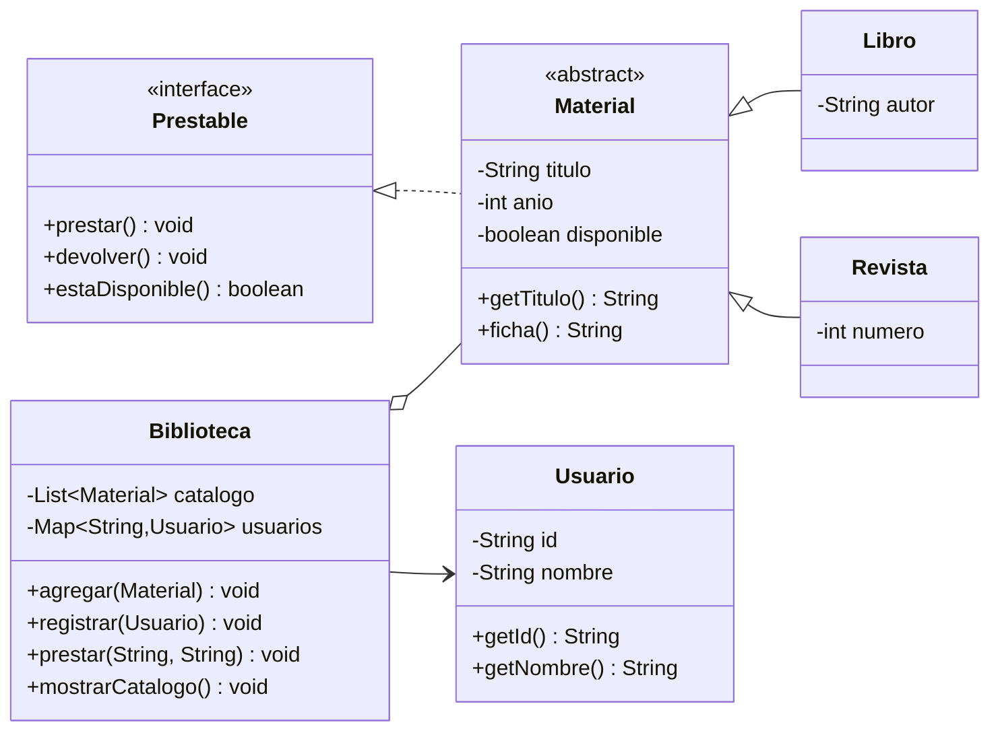

# Apuntes: Programación Orientada a Objetos con Java

La **Programación Orientada a Objetos (POO)** es un paradigma de programación que organiza el software en torno a **objetos**: entidades que combinan **estado** (datos) y **comportamiento** (operaciones). En lugar de pensar en una secuencia global de instrucciones que manipula datos sueltos, la POO diseña unidades autónomas que colaboran entre sí mediante mensajes.

**Java** es uno de los lenguajes más representativos de este paradigma. Nació en Sun Microsystems (creado por James Gosling y liberado en 1995) y actualmente es mantenido por Oracle. Su diseño prioriza la portabilidad, el tipado estático y la orientación a objetos, aunque desde Java 8 incorpora también herramientas funcionales como *lambdas* y *streams*.

> [!NOTE]
> La POO pertenece a la rama **imperativa** de los paradigmas: el programa sigue indicando *cómo* hacer las cosas paso a paso, pero ahora el estado y las operaciones se agrupan dentro de objetos. No es un paradigma declarativo como la programación funcional o la lógica.

> [!NOTE]
> Por legibilidad, algunos ejemplos muestran varias clases en un mismo bloque de código. En un proyecto Java real, cada clase pública debe ir en un archivo `.java` con el mismo nombre.

---

## 1. ¿Por qué surgió la POO?

Conforme los programas crecen, el paradigma procedimental enfrenta problemas difíciles de controlar:

* Los datos globales pueden ser modificados desde cualquier parte del código.
* Una función puede depender de decenas de variables dispersas.
* Reutilizar código suele implicar copiar y pegar.
* Un cambio pequeño puede romper partes del sistema que nadie esperaba.

La POO propone **encapsular** los datos junto con las operaciones que los manipulan, **modelar** el problema con entidades cercanas al mundo real y **reutilizar** comportamiento mediante relaciones entre clases.

### Comparación general

| Aspecto | Programación estructurada | Programación orientada a objetos |
| :--- | :--- | :--- |
| **Unidad principal** | Función o procedimiento | Objeto / clase |
| **Datos** | Variables locales y globales | Atributos encapsulados en objetos |
| **Organización** | Secuencia de pasos y llamadas a funciones | Objetos que colaboran mediante mensajes |
| **Reutilización** | Funciones y bibliotecas | Herencia, composición e interfaces |
| **Extensión** | Se agregan funciones y condicionales | Se agregan clases que cumplen contratos existentes |
| **Abstracción** | Funciones que ocultan detalles | Clases, interfaces y jerarquías |

> [!TIP]
> Un buen diseño orientado a objetos no consiste en crear una clase por cada sustantivo del enunciado. Consiste en repartir **responsabilidades** de forma clara y en reducir el acoplamiento entre partes del sistema.

---

## 2. La plataforma Java

Antes de entrar de lleno en la POO conviene recordar cómo se ejecuta Java, porque muchas de sus características están ligadas a la plataforma.

### 2.1 JDK, JRE y JVM

| Componente | Significado | Qué incluye |
| :--- | :--- | :--- |
| **JVM** (*Java Virtual Machine*) | Máquina virtual que ejecuta el bytecode | Intérprete, compilador JIT, recolector de basura |
| **JRE** (*Java Runtime Environment*) | Entorno para ejecutar aplicaciones Java | JVM + bibliotecas estándar |
| **JDK** (*Java Development Kit*) | Kit para desarrollar aplicaciones | JRE + `javac`, `javadoc`, `jar`, depurador, etc. |

### 2.2 Del código fuente al bytecode

```text
Archivo HolaMundo.java
        │  javac (compilador)
        ▼
Archivo HolaMundo.class (bytecode)
        │  JVM (intérprete + JIT)
        ▼
Código máquina ejecutado por el procesador
```

Java no se compila directamente a código máquina del sistema operativo. Se compila a **bytecode**, un formato intermedio que la JVM interpreta o compila en tiempo de ejecución (*Just-In-Time*). Esto permite el famoso lema:

> **WORA:** *Write Once, Run Anywhere* — escribe una vez, ejecuta en cualquier lugar.

La JVM también administra la memoria automáticamente mediante un **recolector de basura** (*Garbage Collector*), que libera los objetos que ya no son alcanzables. El programador no llama a `free()` ni a `delete` como en C o C++.

### 2.3 Estructura mínima de un programa

```java
public class HolaMundo {
    public static void main(String[] args) {
        System.out.println("¡Hola, Java!");
    }
}
```

Compilación y ejecución desde la terminal:

```bash
javac HolaMundo.java
java HolaMundo
```

* `public class HolaMundo`: declara una clase pública. El archivo debe llamarse `HolaMundo.java`.
* `public static void main(String[] args)`: punto de entrada del programa.
* `System.out.println(...)`: imprime una línea en la salida estándar.

### 2.4 Paquetes e importaciones

Los **paquetes** agrupan clases relacionadas y evitan colisiones de nombres:

```java
package com.miescuela.biblioteca;

import java.util.ArrayList;
import java.util.List;

public class Catalogo {
    private final List<String> titulos = new ArrayList<>();
}
```

* `package` debe ser la primera instrucción (salvo comentarios) del archivo.
* `import` permite usar clases de otros paquetes sin escribir su nombre completamente calificado.
* Por convención, los paquetes se nombran en minúsculas y en orden inverso al dominio: `com.empresa.proyecto`.

### 2.5 Convenciones de nombres

| Elemento | Convención | Ejemplo |
| :--- | :--- | :--- |
| Clase / interfaz | `PascalCase` | `CuentaBancaria`, `Prestable` |
| Método / variable | `camelCase` | `calcularInteres()`, `saldoActual` |
| Constante | `UPPER_SNAKE_CASE` | `TASA_IVA`, `MAX_INTENTOS` |
| Paquete | `lowercase` | `com.escuela.biblioteca` |
| Archivo | Igual que la clase pública | `CuentaBancaria.java` |

---

## 3. Clases y objetos

### 3.1 Clase

Una **clase** es una plantilla o molde que define:

* Los **atributos** que tendrán sus objetos (estado).
* Los **métodos** que podrán ejecutar (comportamiento).
* Las reglas de construcción (constructores).

### 3.2 Objeto

Un **objeto** es una **instancia concreta** de una clase. Se crea con la palabra reservada `new` y ocupa memoria en el *heap*. Cada objeto tiene su propia copia de los atributos de instancia.

> 💡 **Analogía:** la clase es el plano de una casa; los objetos son las casas construidas a partir de ese plano. Todas comparten la estructura, pero cada una tiene su propia dirección, muebles y habitantes.

Todo objeto tiene tres características:

1. **Estado:** valores actuales de sus atributos.
2. **Comportamiento:** operaciones que puede realizar o que se pueden realizar sobre él.
3. **Identidad:** cada objeto es único, aunque dos objetos tengan el mismo estado.

### 3.3 Ejemplo básico

```java
public class Perro {
    // Atributos: estado del objeto
    private String nombre;
    private int edad;

    // Constructor: inicializa el estado
    public Perro(String nombre, int edad) {
        this.nombre = nombre;
        this.edad = edad;
    }

    // Métodos: comportamiento
    public void ladrar() {
        System.out.println(nombre + " dice: ¡Guau!");
    }

    public void cumplirAnios() {
        edad++;
    }

    public String getNombre() {
        return nombre;
    }

    public int getEdad() {
        return edad;
    }
}
```

Uso de la clase:

```java
Perro firulais = new Perro("Firulais", 3);

firulais.ladrar();        // Firulais dice: ¡Guau!
firulais.cumplirAnios();
System.out.println(firulais.getEdad()); // 4
```

### 3.4 Objetos, referencias y memoria

En Java, una variable de tipo objeto **no contiene al objeto**, sino una **referencia** a él:

```java
Perro a = new Perro("Firulais", 3);
Perro b = a; // b y a apuntan al MISMO objeto
```

```text
Stack                         Heap
┌─────────┐                  ┌───────────────────────┐
│ a ──────┼─────────────────►│ Perro                 │
│ b ──────┼─────────────────►│ nombre = "Firulais"   │
└─────────┘                  │ edad = 3              │
                             └───────────────────────┘
```

Por eso, modificar el objeto a través de `b` también se refleja en `a`. Si una referencia no apunta a ningún objeto, su valor es `null`; usarla produce una `NullPointerException`.

```java
Perro c = null;
c.ladrar(); // NullPointerException
```

Los objetos sin referencias alcanzables son liberados eventualmente por el recolector de basura. No es necesario (ni posible) liberarlos manualmente.

---

## 4. Atributos, métodos y constructores

### 4.1 Atributos

Los atributos (o campos) representan el estado. Pueden ser:

* **De instancia:** cada objeto tiene su propia copia.
* **Estáticos (`static`):** pertenecen a la clase y se comparten entre todos los objetos.

```java
public class Alumno {
    private String nombre;          // atributo de instancia
    private static int totalAlumnos; // atributo de clase
}
```

### 4.2 Métodos

Un método encapsula una operación. Su firma incluye el nombre y los tipos de sus parámetros; el tipo de retorno no forma parte de la firma para la sobrecarga.

```java
public double calcularPromedio(double[] calificaciones) {
    double suma = 0;
    for (double calificacion : calificaciones) {
        suma += calificacion;
    }
    return suma / calificaciones.length;
}
```

Un método puede devolver `void` (nada) o un valor de cualquier tipo. Los parámetros se pasan **por valor**: en Java siempre se copia el valor de la variable. Si es un objeto, se copia la **referencia**, no el objeto completo.

> [!WARNING]
> Java **no** tiene paso por referencia al estilo de C++. Cuando pasas un objeto, el método recibe una copia de la referencia. Puede modificar el objeto apuntado, pero no puede hacer que la variable original apunte a otro objeto.

### 4.3 Constructores

Un **constructor** es un método especial que se ejecuta al crear un objeto con `new`. Características:

* Tiene el mismo nombre que la clase.
* No declara tipo de retorno (ni siquiera `void`).
* Puede estar sobrecargado.
* Si no se define ninguno, Java genera un constructor sin parámetros por defecto.
* Si se define al menos uno, el constructor por defecto ya no se genera automáticamente.

```java
public class Cuenta {
    private String titular;
    private double saldo;

    // Constructor sin parámetros
    public Cuenta() {
        this("Sin titular", 0.0);
    }

    // Constructor con parámetros
    public Cuenta(String titular, double saldoInicial) {
        this.titular = titular;
        this.saldo = saldoInicial;
    }
}
```

`this(...)` llama a otro constructor de la misma clase y **debe ser la primera instrucción** del constructor.

### 4.4 La referencia `this`

`this` hace referencia al objeto actual. Se usa para:

* Diferenciar un atributo de un parámetro con el mismo nombre.
* Llamar a otro constructor de la misma clase.
* Pasar el objeto actual como argumento.
* Encadenar métodos (si devuelven `this`).

```java
public class Persona {
    private String nombre;

    public Persona(String nombre) {
        this.nombre = nombre; // this.nombre es el atributo; nombre es el parámetro
    }

    public Persona cambiarNombre(String nombre) {
        this.nombre = nombre;
        return this;
    }
}
```

### 4.5 Miembros estáticos (`static`)

Un miembro `static` pertenece a la **clase**, no a una instancia concreta:

* Se accede mediante `NombreClase.miembro` (aunque Java permite hacerlo desde una instancia, no es recomendable).
* Los métodos estáticos no pueden usar `this` ni acceder directamente a atributos de instancia.
* Se usan para utilidades, constantes, fábricas y contadores globales de la clase.

```java
public class Contador {
    private static int instancias = 0;
    private final int id;

    public Contador() {
        instancias++;
        this.id = instancias;
    }

    public static int getInstancias() {
        return instancias;
    }

    public int getId() {
        return id;
    }
}
```

```java
Contador a = new Contador();
Contador b = new Contador();
System.out.println(Contador.getInstancias()); // 2
```

> [!WARNING]
> Abusa de `static` y terminarás con un estilo procedimental disfrazado de POO. El estado global estático complica las pruebas, el mantenimiento y la concurrencia. Úsalo solo cuando el concepto realmente pertenezca a la clase y no a una instancia.

### 4.6 `final`

La palabra `final` tiene tres usos principales:

| Contexto | Significado |
| :--- | :--- |
| Variable | No puede reasignarse (constante) |
| Método | No puede sobrescribirse en una subclase |
| Clase | No puede heredarse |

```java
public static final double IVA = 0.16; // constante de clase

public final class Utilidades { // no se puede extender
    public final int calcular() { // no se puede sobrescribir
        return 42;
    }
}
```

> [!NOTE]
> Si una variable `final` referencia a un objeto, la **referencia** no puede cambiar, pero el estado interno del objeto sí puede cambiar (salvo que el objeto sea inmutable).
>
> ```java
> final List<String> lista = new ArrayList<>();
> lista.add("Hola"); // permitido: el objeto sigue siendo el mismo
> // lista = new ArrayList<>(); // error de compilación
> ```

### 4.7 Orden de inicialización

Al crear un objeto, Java sigue este orden aproximado:

1. Inicialización estática de la superclase (solo la primera vez).
2. Inicialización estática de la clase (solo la primera vez).
3. Inicialización de atributos de instancia de la superclase.
4. Constructor de la superclase.
5. Inicialización de atributos de instancia de la clase.
6. Constructor de la clase.

Los bloques de inicialización (`{ ... }`) y los bloques estáticos (`static { ... }`) se ejecutan en este orden. En la práctica, es mejor inicializar en el constructor para mantener el código claro.

### 4.8 Inferencia de tipos local con `var`

Desde Java 10 se puede usar `var` para variable locales, siempre que el compilador pueda inferir el tipo:

```java
var nombres = new ArrayList<String>(); // ArrayList<String>
var edad = 25;                          // int
```

No se puede usar `var` en atributos de clase, parámetros, tipos de retorno ni para declarar una variable sin inicializar. Tampoco convierte a Java en un lenguaje de tipado dinámico: el tipo se fija en tiempo de compilación.

---

## 5. Encapsulamiento

El **encapsulamiento** consiste en ocultar los detalles internos de un objeto y exponer solo una interfaz controlada. Su objetivo es proteger la consistencia del estado y reducir el acoplamiento.

### 5.1 Modificadores de acceso

| Modificador | Misma clase | Mismo paquete | Subclase (otro paquete) | Cualquier clase |
| :--- | :---: | :---: | :---: | :---: |
| `private` | ✅ | ❌ | ❌ | ❌ |
| *Sin modificador* (*package-private*) | ✅ | ✅ | ❌ | ❌ |
| `protected` | ✅ | ✅ | ✅ | ❌ |
| `public` | ✅ | ✅ | ✅ | ✅ |

* Los **atributos** suelen declararse `private`.
* Los **métodos** que forman la interfaz pública se declaran `public`.
* `protected` se usa cuando una subclase necesita acceder al miembro; también permite acceso dentro del mismo paquete.
* A nivel de clases externas, solo se permite `public` o *package-private*.

### 5.2 Getters y setters

Los **getters** permiten leer un atributo y los **setters** modificarlo, aplicando validaciones si es necesario:

```java
public class CuentaBancaria {
    private final String numero;
    private double saldo;

    public CuentaBancaria(String numero, double saldoInicial) {
        if (saldoInicial < 0) {
            throw new IllegalArgumentException("El saldo inicial no puede ser negativo");
        }
        this.numero = numero;
        this.saldo = saldoInicial;
    }

    public String getNumero() {
        return numero;
    }

    public double getSaldo() {
        return saldo;
    }

    public void depositar(double monto) {
        if (monto <= 0) {
            throw new IllegalArgumentException("El monto debe ser positivo");
        }
        saldo += monto;
    }

    public void retirar(double monto) {
        if (monto <= 0) {
            throw new IllegalArgumentException("El monto debe ser positivo");
        }
        if (monto > saldo) {
            throw new IllegalStateException("Saldo insuficiente");
        }
        saldo -= monto;
    }
}
```

Observa que **no existe** `setSaldo(...)`: el saldo solo cambia mediante operaciones con sentido de negocio (`depositar`, `retirar`). Esto evita estados inválidos.

### 5.3 Exponer colecciones internas

Un error común es devolver directamente una colección mutable:

```java
// ❌ Mal: cualquiera puede modificar la lista interna
public List<String> getNombres() {
    return nombres;
}
```

Soluciones:

```java
// ✅ Opción 1: devolver una copia inmutable
public List<String> getNombres() {
    return List.copyOf(nombres);
}

// ✅ Opción 2: devolver una vista no modificable
public List<String> getNombres() {
    return Collections.unmodifiableList(nombres);
}
```

### 5.4 JavaBeans y convenciones

El estándar **JavaBeans** define convenciones para clases reutilizables:

* Constructor sin argumentos.
* Atributos privados.
* Métodos `getX()` / `setX()` para acceder a las propiedades.
* Implementar `Serializable` (cuando se requiere persistencia o transferencia).

```java
public class UsuarioBean {
    private String nombre;

    public UsuarioBean() { }

    public String getNombre() {
        return nombre;
    }

    public void setNombre(String nombre) {
        this.nombre = nombre;
    }
}
```

En código moderno, los `record` (ver sección 10.4) sustituyen a muchos JavaBeans inmutables.

---

## 6. Herencia

La **herencia** permite que una clase (**subclase** o clase hija) reutilice y especialice el comportamiento de otra (**superclase** o clase padre). Representa una relación **“es un”** (*is-a*).

### 6.1 Sintaxis y ejemplo

```java
public class Animal {
    private final String nombre;

    public Animal(String nombre) {
        this.nombre = nombre;
    }

    public String getNombre() {
        return nombre;
    }

    public void comer() {
        System.out.println(nombre + " está comiendo.");
    }

    public String sonido() {
        return "...";
    }
}
```

```java
public class Perro extends Animal {
    public Perro(String nombre) {
        super(nombre);
    }

    @Override
    public String sonido() {
        return "Guau";
    }

    public void moverCola() {
        System.out.println(getNombre() + " mueve la cola.");
    }
}
```

```java
public class Gato extends Animal {
    public Gato(String nombre) {
        super(nombre);
    }

    @Override
    public String sonido() {
        return "Miau";
    }
}
```

Uso:

```java
Animal firulais = new Perro("Firulais");
Animal michi = new Gato("Michi");

firulais.comer();               // Firulais está comiendo.
System.out.println(michi.sonido()); // Miau
```

### 6.2 La palabra `super`

`super` permite acceder a la superclase:

* `super(...)` llama al constructor de la superclase y debe ser la primera instrucción del constructor.
* `super.metodo()` invoca una versión sobrescrita de la superclase.
* `super.atributo` accede a un atributo de la superclase (poco común y generalmente evitable).

Si un constructor no llama explícitamente a `super(...)`, Java inserta una llamada al constructor sin argumentos de la superclase. Si la superclase no tiene ese constructor, el código no compila.

### 6.3 Sobrescritura (`@Override`)

Una subclase **sobrescribe** un método cuando proporciona su propia implementación con la misma firma:

```java
@Override
public String sonido() {
    return "Guau";
}
```

`@Override` es una anotación opcional pero muy recomendable: si el método no sobrescribe realmente nada (por un error de nombre o de parámetros), el compilador lo detecta.

Reglas de sobrescritura:

* El método debe tener el mismo nombre y los mismos parámetros.
* El tipo de retorno puede ser igual o un subtipo (**retorno covariante**).
* No se puede reducir la visibilidad (por ejemplo, de `public` a `protected`).
* No se pueden lanzar excepciones *checked* más amplias que las declaradas por el método original.
* Los métodos `final`, `static` y `private` **no** se pueden sobrescribir. Los `static` se ocultan, no se sobrescriben.

### 6.4 Jerarquía y clase `Object`

En Java **todas las clases heredan implícitamente de `java.lang.Object`**, directa o indirectamente. Por eso todo objeto dispone de métodos como `toString()`, `equals()` y `hashCode()`.

```java
public class Perro extends Animal { }
// equivale a: public class Perro extends Animal, y Animal extends Object
```

La herencia de clases en Java es **simple**: una clase solo puede extender una superclase. La herencia múltiple de estado no existe para evitar ambigüedades (el “problema del diamante” de C++). La herencia múltiple de **tipo** se consigue con interfaces.

### 6.5 Herencia frente a composición

La herencia crea un acoplamiento fuerte: la subclase depende de los detalles de implementación de la superclase. Por eso se recomienda:

> **Favorece la composición sobre la herencia.**

* Usa **herencia** cuando exista una relación *is-a* genuina y la superclase esté diseñada para ser extendida.
* Usa **composición** cuando solo quieras reutilizar comportamiento (*has-a*).

Ejemplo de mal uso:

```java
// ❌ Un Pato no "es un" ArrayList, aunque pueda contener patitos
class Pato extends ArrayList<Pato> { }
```

Ejemplo correcto con composición:

```java
class Pato {
    private final List<Pato> patitos = new ArrayList<>();
}
```

> [!WARNING]
> No heredes solo para reutilizar código. Si la relación “es un” no tiene sentido en el dominio, probablemente la composición sea mejor.

---

## 7. Polimorfismo

El **polimorfismo** es la capacidad de que un mismo mensaje (llamada a método) produzca comportamientos diferentes según el objeto concreto que lo recibe. Es el mecanismo que permite escribir código genérico que trabaja con una superclase o interfaz y, aun así, ejecutar la implementación específica de cada subtipo.

### 7.1 Sobrecarga (polimorfismo en tiempo de compilación)

La **sobrecarga** (*overloading*) ocurre cuando varios métodos de la misma clase tienen el mismo nombre pero diferente lista de parámetros:

```java
public class Calculadora {
    public int sumar(int a, int b) {
        return a + b;
    }

    public double sumar(double a, double b) {
        return a + b;
    }

    public int sumar(int a, int b, int c) {
        return a + b + c;
    }
}
```

El compilador decide qué versión llamar según los tipos de los argumentos. El tipo de retorno **no** basta para distinguir sobrecargas:

```java
public int obtener() { return 1; }
public double obtener() { return 1.0; } // ❌ error: misma firma
```

### 7.2 Sobrescritura y enlace dinámico

La **sobrescritura** (*overriding*) se resuelve en tiempo de ejecución mediante **despacho dinámico** (*dynamic dispatch*): la JVM ejecuta el método de la clase real del objeto, no la del tipo de la variable.

```java
Animal[] animales = {
    new Perro("Firulais"),
    new Gato("Michi")
};

for (Animal animal : animales) {
    System.out.println(animal.getNombre() + " dice " + animal.sonido());
}
```

Salida:

```text
Firulais dice Guau
Michi dice Miau
```

Aunque la variable sea de tipo `Animal`, se ejecuta `Perro.sonido()` o `Gato.sonido()` según corresponda. Este es el corazón del polimorfismo.

### 7.3 Sobrecarga vs. sobrescritura

| Característica | Sobrecarga (*overloading*) | Sobrescritura (*overriding*) |
| :--- | :--- | :--- |
| **Dónde ocurre** | Misma clase (o jerarquía) | Clase derivada |
| **Firma** | Debe cambiar la lista de parámetros | Debe ser igual |
| **Resolución** | En tiempo de compilación | En tiempo de ejecución |
| **Tipo de retorno** | Puede variar libremente | Igual o covariante |
| **Visibilidad** | Independiente | No puede reducirse |
| **Polimorfismo** | Estático | Dinámico |

### 7.4 Conversiones de tipo

**Upcasting** (de subclase a superclase): siempre es seguro y automático.

```java
Animal animal = new Perro("Firulais"); // upcasting implícito
```

**Downcasting** (de superclase a subclase): requiere conversión explícita y puede fallar en tiempo de ejecución.

```java
Animal animal = new Perro("Firulais");
Perro perro = (Perro) animal; // válido porque el objeto real es un Perro
```

```java
Animal animal = new Gato("Michi");
Perro perro = (Perro) animal; // ClassCastException
```

### 7.5 `instanceof` y pattern matching

Para comprobar el tipo antes de convertir:

```java
if (animal instanceof Perro) {
    Perro perro = (Perro) animal;
    perro.moverCola();
}
```

Desde Java 16 se puede usar **pattern matching** para simplificar:

```java
if (animal instanceof Perro perro) {
    perro.moverCola();
}
```

También existe `instanceof` con negación:

```java
if (!(animal instanceof Perro perro)) {
    return;
}
perro.moverCola();
```

> [!NOTE]
> Abusar de `instanceof` y de conversiones indica que el diseño podría mejorar. Si el código pregunta constantemente por el tipo concreto, quizá convenga agregar un método polimórfico en la jerarquía o aplicar un patrón como *Strategy* o *Visitor*.

### 7.6 Reglas de despacho para métodos estáticos

Los métodos `static` **no** son polimórficos: se resuelven según el tipo de la variable, no según el objeto.

```java
class Padre {
    static void saludar() { System.out.println("Padre"); }
}

class Hijo extends Padre {
    static void saludar() { System.out.println("Hijo"); }
}

Padre referencia = new Hijo();
referencia.saludar(); // Padre (se resuelve por el tipo de la variable)
```

Por eso los métodos estáticos no deberían usarse para implementar comportamiento polimórfico.

---

## 8. Abstracción: clases abstractas e interfaces

La **abstracción** consiste en modelar solo los aspectos relevantes de un concepto, ocultando los detalles innecesarios. En Java se expresa principalmente con clases abstractas e interfaces.

### 8.1 Clases abstractas

Una **clase abstracta** no puede instanciarse y puede contener:

* Atributos de instancia.
* Constructores.
* Métodos concretos (con implementación).
* Métodos abstractos (sin implementación), que obligan a las subclases a definirlos.

```java
public abstract class Figura {
    protected final String nombre;

    protected Figura(String nombre) {
        this.nombre = nombre;
    }

    public abstract double area();

    public void mostrar() {
        System.out.printf("%s tiene un área de %.2f%n", nombre, area());
    }
}
```

```java
public class Circulo extends Figura {
    private final double radio;

    public Circulo(double radio) {
        super("Círculo");
        this.radio = radio;
    }

    @Override
    public double area() {
        return Math.PI * radio * radio;
    }
}
```

Una clase abstracta puede tener métodos abstractos y concretos. Si una subclase no implementa todos los métodos abstractos, también debe declararse abstracta.

### 8.2 Interfaces

Una **interfaz** define un **contrato**: un conjunto de métodos que una clase se compromete a implementar. No se puede instanciar.

```java
public interface Prestable {
    void prestar();
    void devolver();
    boolean estaDisponible();
}
```

```java
public class Libro implements Prestable {
    private boolean disponible = true;

    @Override
    public void prestar() {
        disponible = false;
    }

    @Override
    public void devolver() {
        disponible = true;
    }

    @Override
    public boolean estaDisponible() {
        return disponible;
    }
}
```

Una clase puede implementar **varias interfaces**:

```java
public class Revista implements Prestable, Catalogable {
    // ...
}
```

Los campos de una interfaz son implícitamente `public static final` (constantes). Los métodos abstractos son implícitamente `public abstract`.

### 8.3 Métodos `default`, `static` y `private` en interfaces

Desde Java 8, las interfaces pueden tener métodos `default` (con implementación) y `static`. Desde Java 9, también métodos `private` auxiliares.

```java
public interface Redimensionable {
    void redimensionar(double factor);

    default void redimensionarAlDoble() {
        validarFactor(2.0);
        redimensionar(2.0);
    }

    static Redimensionable identidad() {
        return factor -> { }; // interfaz funcional
    }

    private void validarFactor(double factor) {
        if (factor <= 0) {
            throw new IllegalArgumentException("El factor debe ser positivo");
        }
    }
}
```

Los métodos `default` permiten agregar comportamiento a una interfaz sin romper las clases existentes, pero deben usarse con cuidado para no crear jerarquías ambiguas.

### 8.4 Clases abstractas vs. interfaces

| Criterio | Clase abstracta | Interfaz |
| :--- | :--- | :--- |
| **Herencia** | Simple (`extends`) | Múltiple (`implements`) |
| **Estado** | Puede tener atributos de instancia | Solo constantes (`public static final`) |
| **Constructores** | Sí | No |
| **Métodos** | Abstractos y concretos | Abstractos, `default`, `static`, `private` |
| **Relación** | “Es un” fuerte; base común | Contrato o capacidad |
| **Uso típico** | Compartir estado y código base | Definir comportamiento común desacoplado |

Regla práctica:

* Usa **interfaz** para definir *qué* debe hacer algo, sin imponer una jerarquía de estado.
* Usa **clase abstracta** cuando varias clases comparten estado o una implementación parcial.
* Una clase puede extender una sola clase abstracta, pero implementar muchas interfaces.

### 8.5 Clases y interfaces selladas (`sealed`)

Desde Java 17, una clase o interfaz puede declararse `sealed` para restringir qué tipos pueden heredar de ella. Las subclases deben ser `final`, `sealed` o `non-sealed`.

```java
public sealed interface Forma permits Circulo, Cuadrado { }

public final class Circulo implements Forma {
    // ...
}

public final class Cuadrado implements Forma {
    // ...
}
```

Esto permite modelar jerarquías cerradas y habilita análisis exhaustivos, algo útil en combinación con `switch` de patrones (Java 21).

### 8.6 ¿Cuándo usar cada una?

* **Interfaz:** cuando quieres que clases no relacionadas compartan una capacidad (`Comparable`, `Runnable`, `Prestable`) o necesitas desacoplar módulos.
* **Clase abstracta:** cuando hay una base común con estado y comportamiento parcial (`Figura`, `Empleado`, `Cuenta`).
* **Ninguna de las dos:** si no hay comportamiento común real, no fuerces una jerarquía. La composición suele ser más flexible.

---

## 9. Relaciones entre clases

En POO las clases no viven aisladas: se relacionan. UML distingue varios tipos de relaciones.

### 9.1 Dependencia

Una clase **usa** a otra de forma temporal (como parámetro, variable local o valor de retorno). Es la relación más débil.

```java
public class Impresora {
    public void imprimir(Documento documento) {
        System.out.println(documento.contenido());
    }
}
```

`Impresora` depende de `Documento`, pero no lo almacena.

### 9.2 Asociación

Una clase **tiene una referencia** a otra como atributo, y ambas viven de forma independiente.

```java
public class Profesor {
    private final String nombre;
    // ...
}

public class Curso {
    private Profesor profesor; // asociación

    public Curso(Profesor profesor) {
        this.profesor = profesor;
    }
}
```

### 9.3 Agregación

Es una asociación **todo-parte** débil: el todo contiene partes, pero las partes pueden existir sin el todo. El ciclo de vida de las partes no es controlado por el todo.

```java
public class Equipo {
    private final List<Jugador> jugadores;

    public Equipo(List<Jugador> jugadores) {
        this.jugadores = new ArrayList<>(jugadores);
    }
}
```

Los `Jugador` existen antes y pueden seguir existiendo después del `Equipo`. En UML se representa con un **rombo hueco** en el lado del todo.

### 9.4 Composición

Es una relación **todo-parte** fuerte: el todo crea y posee las partes, y si el todo se destruye, las partes también dejan de ser útiles. En UML se representa con un **rombo relleno**.

```java
public class Motor {
    public void encender() {
        System.out.println("Motor encendido");
    }
}

public class Automovil {
    private final Motor motor; // composición: el automóvil crea su motor

    public Automovil() {
        this.motor = new Motor();
    }

    public void arrancar() {
        motor.encender();
    }
}
```

> [!NOTE]
> En Java no existe una diferencia sintáctica entre agregación y composición: ambas se implementan con atributos de referencia. La diferencia está en el **diseño** y en quién controla el ciclo de vida de los objetos.

### 9.5 Herencia y realización

* **Herencia** (*generalization*): relación “es un” entre clases. Se representa con una flecha de triángulo hueco.
* **Realización** (*realization*): una clase implementa una interfaz. Se representa con una flecha de triángulo hueco y línea discontinua.

### 9.6 Resumen de relaciones UML

| Relación | Notación UML | Idea | Ejemplo |
| :--- | :--- | :--- | :--- |
| Dependencia | Flecha discontinua `- - ▷` | Usa temporalmente | `Impresora` usa `Documento` |
| Asociación | Línea continua `——` | Tiene una referencia | `Curso` tiene `Profesor` |
| Agregación | Rombo hueco `◇——` | Todo-parte débil | `Equipo` contiene `Jugador` |
| Composición | Rombo relleno `◆——` | Todo-parte fuerte | `Automóvil` posee `Motor` |
| Herencia | Triángulo hueco `——▷` | Es-un | `Perro` es `Animal` |
| Realización | Triángulo hueco discontinuo `- - ▷` | Implementa contrato | `Libro` implementa `Prestable` |

---

## 10. La clase `Object` y sus contratos

Todas las clases heredan de `java.lang.Object`. Sus métodos más importantes son:

| Método | Propósito |
| :--- | :--- |
| `toString()` | Representación textual del objeto |
| `equals(Object obj)` | Comparación lógica por contenido |
| `hashCode()` | Código hash para tablas hash |
| `getClass()` | Devuelve la clase real del objeto |
| `clone()` | Crea una copia (requiere implementar `Cloneable`) |
| `finalize()` | Limpieza antes de recolectar (obsoleto; no usar) |

### 10.1 `toString()`

La implementación por defecto devuelve algo como `Perro@1b6d3586`, poco útil. Conviene sobrescribirla:

```java
@Override
public String toString() {
    return "Perro{nombre='" + nombre + "', edad=" + edad + "}";
}
```

### 10.2 `equals()` y `hashCode()`

`equals()` por defecto compara **identidad** (como `==`). Si quieres comparar por contenido, debes sobrescribirlo.

El contrato de `equals()` exige que sea:

* **Reflexivo:** `x.equals(x)` debe ser `true`.
* **Simétrico:** `x.equals(y)` debe ser igual a `y.equals(x)`.
* **Transitivo:** si `x.equals(y)` y `y.equals(z)`, entonces `x.equals(z)`.
* **Consistente:** el resultado no debe cambiar si los objetos no cambian.
* **Con `null`:** `x.equals(null)` debe ser `false`.

Además, **si sobrescribes `equals()`, debes sobrescribir `hashCode()`**. Si dos objetos son iguales según `equals()`, deben tener el mismo `hashCode()`. De lo contrario, `HashMap` y `HashSet` funcionarán incorrectamente.

```java
import java.util.Objects;

public class Punto {
    private final int x;
    private final int y;

    public Punto(int x, int y) {
        this.x = x;
        this.y = y;
    }

    @Override
    public boolean equals(Object otro) {
        if (this == otro) {
            return true;
        }
        if (!(otro instanceof Punto punto)) {
            return false;
        }
        return x == punto.x && y == punto.y;
    }

    @Override
    public int hashCode() {
        return Objects.hash(x, y);
    }

    @Override
    public String toString() {
        return "Punto(" + x + ", " + y + ")";
    }
}
```

### 10.3 `==` vs. `equals()`

* `==` compara **referencias** (si apuntan al mismo objeto) para tipos objeto, y **valores** para tipos primitivos.
* `equals()` compara **contenido**, si la clase lo ha sobrescrito correctamente.

```java
String a = new String("Hola");
String b = new String("Hola");

System.out.println(a == b);      // false (objetos distintos)
System.out.println(a.equals(b)); // true (mismo contenido)
```

> [!WARNING]
> Nunca compares cadenas con `==` salvo que quieras comprobar identidad de referencia. Usa siempre `equals()` o `Objects.equals(a, b)`.

---

## 11. Clases anidadas, `enum` y `record`

### 11.1 Clases anidadas

Una clase puede declararse dentro de otra:

* **Clase interna de instancia** (*inner class*): tiene acceso al estado del objeto externo.
* **Clase anidada estática**: no tiene referencia implícita al objeto externo.
* **Clase local**: definida dentro de un método.
* **Clase anónima**: implementación sin nombre, útil para interfaces funcionales.

```java
public class Externa {
    private int valor = 10;

    public class Interna {
        public void mostrar() {
            System.out.println(valor); // accede al estado del objeto externo
        }
    }

    public static class AnidadaEstatica {
        public void saludar() {
            System.out.println("Hola desde una clase anidada estática");
        }
    }
}
```

```java
Externa externa = new Externa();
Externa.Interna interna = externa.new Interna();
interna.mostrar();

Externa.AnidadaEstatica anidada = new Externa.AnidadaEstatica();
anidada.saludar();
```

### 11.2 Clases anónimas y lambdas

```java
Runnable tarea = new Runnable() {
    @Override
    public void run() {
        System.out.println("Ejecutando tarea");
    }
};
```

Equivalente con lambda (Java 8+), porque `Runnable` es una interfaz funcional:

```java
Runnable tarea = () -> System.out.println("Ejecutando tarea");
```

### 11.3 Enumeraciones (`enum`)

Un `enum` define un conjunto fijo de constantes con tipo seguro. Puede tener atributos, constructores, métodos e implementar interfaces.

```java
public enum EstadoPedido {
    PENDIENTE("Pendiente de pago"),
    PAGADO("Pagado"),
    ENVIADO("En camino"),
    ENTREGADO("Entregado");

    private final String descripcion;

    EstadoPedido(String descripcion) { // constructor implícitamente privado
        this.descripcion = descripcion;
    }

    public String getDescripcion() {
        return descripcion;
    }
}
```

```java
EstadoPedido estado = EstadoPedido.PAGADO;

if (estado == EstadoPedido.PAGADO) {
    System.out.println(estado.getDescripcion());
}

switch (estado) {
    case PENDIENTE -> System.out.println("Falta pago");
    case PAGADO -> System.out.println("Listo para enviar");
    case ENVIADO -> System.out.println("En tránsito");
    case ENTREGADO -> System.out.println("Completado");
}
```

Los `enum` son ideales para estados, categorías, días de la semana, niveles, etc. Además, `EnumSet` y `EnumMap` son colecciones optimizadas para ellos.

### 11.4 Records (Java 16+)

Un `record` es una clase inmutable cuyo propósito es transportar datos. El compilador genera automáticamente:

* Constructor canónico.
* Accesores con el nombre del componente (`nombre()`, no `getNombre()`).
* `equals()`, `hashCode()` y `toString()`.
* Campos `private final`.

```java
public record Producto(String nombre, double precio) {
    // Constructor compacto: validación
    public Producto {
        if (precio < 0) {
            throw new IllegalArgumentException("El precio no puede ser negativo");
        }
    }

    public double precioConIva() {
        return precio * 1.16;
    }
}
```

```java
Producto producto = new Producto("Laptop", 15000);
System.out.println(producto.nombre());       // Laptop
System.out.println(producto.precioConIva()); // 17400.0
```

Características de los `record`:

* Son implícitamente `final` y extienden `java.lang.Record`.
* No pueden extender otra clase.
* Sus componentes son `private final`.
* Pueden implementar interfaces.
* Pueden tener métodos, constructores adicionales y campos `static`.
* No pueden declarar campos de instancia adicionales.
* La inmutabilidad es **superficial**: si un componente es una referencia a un objeto mutable, ese objeto puede cambiar.

> [!TIP]
> Usa `record` para DTOs, resultados, coordenadas, pares clave-valor y datos inmutables. Usa clases normales cuando necesites identidad mutable o herencia.

### 11.5 Anotaciones

Las **anotaciones** agregan metadatos al código. Java incluye algunas de uso común:

| Anotación | Uso |
| :--- | :--- |
| `@Override` | Indica que un método sobrescribe otro |
| `@Deprecated` | Marca código obsoleto |
| `@SuppressWarnings` | Silencia advertencias específicas del compilador |
| `@FunctionalInterface` | Verifica que una interfaz tenga un solo método abstracto |
| `@SafeVarargs` | Suprime advertencias de genéricos con varargs |

También puedes definir tus propias anotaciones, aunque eso ya pertenece a temas más avanzados de Java.

---

## 12. Genéricos y colecciones

### 12.1 Genéricos

Los **genéricos** permiten escribir clases y métodos que funcionan con distintos tipos manteniendo la seguridad de tipos:

```java
public class Caja<T> {
    private T contenido;

    public void guardar(T contenido) {
        this.contenido = contenido;
    }

    public T obtener() {
        return contenido;
    }
}
```

```java
Caja<String> caja = new Caja<>();
caja.guardar("Hola");
String texto = caja.obtener(); // sin cast

Caja<Integer> otra = new Caja<>();
otra.guardar(42);
```

Sin genéricos, `obtener()` devolvería `Object` y habría que hacer conversiones inseguras.

#### Tipos acotados

```java
public static <T extends Comparable<T>> T maximo(List<T> lista) {
    T max = lista.get(0);
    for (T elemento : lista) {
        if (elemento.compareTo(max) > 0) {
            max = elemento;
        }
    }
    return max;
}
```

#### Comodines (*wildcards*)

```java
// ? extends Number: acepta List<Integer>, List<Double>, etc.
public static double sumar(List<? extends Number> numeros) {
    double suma = 0;
    for (Number n : numeros) {
        suma += n.doubleValue();
    }
    return suma;
}

// ? super Integer: acepta List<Integer>, List<Number>, List<Object>
public static void agregarEnteros(List<? super Integer> lista) {
    lista.add(1);
    lista.add(2);
}
```

Regla **PECS**: *Producer Extends, Consumer Super*.

* Si la colección **produce** valores que vas a leer, usa `? extends T`.
* Si la colección **consume** valores que vas a escribir, usa `? super T`.

> [!NOTE]
> Los genéricos en Java se implementan mediante **type erasure**: la información de tipos se borra en tiempo de ejecución. Por eso no puedes hacer `new T()`, `T.class` ni crear arreglos genéricos directamente. El compilador inserta conversiones y garantiza la seguridad de tipos en compilación.

### 12.2 Colecciones

El **Java Collections Framework** proporciona interfaces e implementaciones para agrupar objetos. Jerarquía simplificada:

```text
Iterable
   └── Collection
          ├── List
          ├── Set
          └── Queue
                 └── Deque

Map (no hereda de Collection)
   ├── HashMap
   ├── LinkedHashMap
   └── TreeMap
```

| Interfaz | Característica | Implementaciones comunes |
| :--- | :--- | :--- |
| `List` | Ordenada, permite duplicados, acceso por índice | `ArrayList`, `LinkedList` |
| `Set` | Sin duplicados | `HashSet`, `LinkedHashSet`, `TreeSet` |
| `Queue` | Cola (FIFO, prioridades) | `ArrayDeque`, `PriorityQueue`, `LinkedList` |
| `Deque` | Cola doble / pila | `ArrayDeque`, `LinkedList` |
| `Map` | Clave-valor, claves únicas | `HashMap`, `LinkedHashMap`, `TreeMap` |

Ejemplo:

```java
import java.util.ArrayList;
import java.util.HashMap;
import java.util.List;
import java.util.Map;

List<String> nombres = new ArrayList<>();
nombres.add("Ana");
nombres.add("Luis");
nombres.add("Ana"); // permitido en List

Map<String, Integer> edades = new HashMap<>();
edades.put("Ana", 22);
edades.put("Luis", 25);

for (Map.Entry<String, Integer> entrada : edades.entrySet()) {
    System.out.println(entrada.getKey() + " -> " + entrada.getValue());
}
```

Notas prácticas:

* `ArrayList` suele ser la opción por defecto para listas; `LinkedList` rara vez es mejor en la práctica.
* `HashSet`/`HashMap` no garantizan orden; `LinkedHashSet`/`LinkedHashMap` mantienen orden de inserción; `TreeSet`/`TreeMap` mantienen orden natural o según un `Comparator`.
* `ArrayDeque` es preferible a `Stack` y a `LinkedList` para pilas y colas.
* `Vector` y `Hashtable` son clases antiguas sincronizadas; en código moderno se prefieren las colecciones concurrentes de `java.util.concurrent`.

### 12.3 Lambdas, interfaces funcionales y streams

Desde Java 8, Java incorpora elementos del paradigma funcional.

Una **interfaz funcional** tiene exactamente un método abstracto:

```java
@FunctionalInterface
public interface Operacion {
    int aplicar(int a, int b);
}
```

Una **lambda** es una implementación concisa de esa interfaz:

```java
Operacion suma = (a, b) -> a + b;
Operacion multiplicacion = (a, b) -> a * b;

System.out.println(suma.aplicar(3, 4));          // 7
System.out.println(multiplicacion.aplicar(3, 4)); // 12
```

Los **streams** permiten procesar colecciones de forma declarativa:

```java
List<String> nombres = List.of("Ana", "Luis", "Alejandra", "Pedro");

List<String> resultado = nombres.stream()
    .filter(nombre -> nombre.length() > 3)
    .map(String::toUpperCase)
    .sorted()
    .toList(); // Java 16+

System.out.println(resultado); // [ALEJANDRA, PEDRO]
```

Operaciones intermedias (`filter`, `map`, `sorted`, `distinct`, `limit`) son perezosas; las terminales (`toList`, `collect`, `forEach`, `count`, `reduce`, `anyMatch`) disparan el procesamiento.

> [!TIP]
> Aunque Java es principalmente orientado a objetos, las lambdas y streams permiten un estilo más declarativo. Esto convierte a Java en un lenguaje **multiparadigma** en la práctica.

### 12.4 `Optional`

`Optional<T>` representa un valor que puede estar presente o ausente, evitando devolver `null` en la interfaz pública:

```java
public Optional<Usuario> buscarPorId(String id) {
    return usuarios.stream()
        .filter(u -> u.getId().equals(id))
        .findFirst();
}
```

```java
buscarPorId("u001").ifPresentOrElse(
    usuario -> System.out.println("Encontrado: " + usuario.getNombre()),
    () -> System.out.println("Usuario no encontrado")
);
```

> [!WARNING]
> `Optional` está pensado para **valores de retorno**. No lo uses como atributo de clase ni como parámetro de métodos, y evita llamar a `get()` sin comprobar antes el valor; prefiere `orElse`, `orElseThrow`, `ifPresent`, `map`, etc.

---

## 13. Manejo de excepciones

Las excepciones permiten separar el flujo normal del manejo de errores. En Java, todos los errores y excepciones heredan de `Throwable`.

```text
Throwable
   ├── Error (problemas graves de la JVM; no se suelen capturar)
   └── Exception
          ├── RuntimeException (no comprobadas / unchecked)
          └── Otras excepciones (comprobadas / checked)
```

### 13.1 Excepciones comprobadas y no comprobadas

* **Checked:** el compilador obliga a capturarlas o declararlas con `throws`. Ejemplos: `IOException`, `SQLException`, `ClassNotFoundException`.
* **Unchecked (`RuntimeException`):** no es obligatorio capturarlas. Suelen indicar errores de programación. Ejemplos: `NullPointerException`, `IllegalArgumentException`, `IndexOutOfBoundsException`, `ArithmeticException`.
* **Error:** condiciones graves de la JVM (`OutOfMemoryError`, `StackOverflowError`). Generalmente no se capturan.

### 13.2 `try`, `catch`, `finally`

```java
try {
    int resultado = 10 / 0;
} catch (ArithmeticException e) {
    System.err.println("No se puede dividir entre cero: " + e.getMessage());
} finally {
    System.out.println("Bloque finally: siempre se ejecuta");
}
```

* `try` contiene el código que puede fallar.
* `catch` captura y maneja un tipo específico de excepción. Puedes tener varios `catch`, del más específico al más general.
* `finally` se ejecuta siempre (haya o no excepción), salvo que la JVM termine abruptamente.

### 13.3 `throw` y `throws`

* `throw` lanza una excepción en un punto del código.
* `throws` declara que un método puede lanzar excepciones comprobadas.

```java
public class SaldoInsuficienteException extends Exception {
    public SaldoInsuficienteException(String mensaje) {
        super(mensaje);
    }
}
```

```java
public void retirar(double monto) throws SaldoInsuficienteException {
    if (monto > saldo) {
        throw new SaldoInsuficienteException("Saldo insuficiente: " + saldo);
    }
    saldo -= monto;
}
```

Uso:

```java
try {
    cuenta.retirar(500);
} catch (SaldoInsuficienteException e) {
    System.err.println("No se pudo retirar: " + e.getMessage());
}
```

### 13.4 `try-with-resources`

Desde Java 7, los recursos que implementan `AutoCloseable` se cierran automáticamente:

```java
try (BufferedReader br = Files.newBufferedReader(Path.of("datos.txt"))) {
    String linea;
    while ((linea = br.readLine()) != null) {
        System.out.println(linea);
    }
} catch (IOException e) {
    System.err.println("Error al leer el archivo: " + e.getMessage());
}
```

El recurso se cierra aunque ocurra una excepción. Es la forma recomendada de trabajar con archivos, conexiones y flujos.

### 13.5 Buenas prácticas con excepciones

* Captura solo lo que puedes manejar.
* No ignores excepciones con un `catch` vacío.
* No uses excepciones para control de flujo normal.
* Lanza excepciones específicas, no `Exception` genérica.
* No reveles detalles internos sensibles en los mensajes.
* Usa `try-with-resources` para recursos.
* No retornes desde `finally`: puede ocultar excepciones.
* Documenta las excepciones comprobadas en Javadoc con `@throws`.

> [!WARNING]
> Un `catch (Exception e) { }` vacío es una de las peores prácticas posibles: el programa falla silenciosamente y el error se vuelve muy difícil de diagnosticar.

---

## 14. Principios de diseño SOLID

**SOLID** es un conjunto de cinco principios para diseñar sistemas orientados a objetos mantenibles y flexibles.

| Principio | Idea central | Señal de violación |
| :--- | :--- | :--- |
| **S** — *Single Responsibility* | Una clase debe tener una sola razón para cambiar | Clase que mezcla persistencia, UI y lógica de negocio |
| **O** — *Open/Closed* | Abierta a extensión, cerrada a modificación | Cada nuevo tipo obliga a modificar un `switch` gigante |
| **L** — *Liskov Substitution* | Un subtipo debe poder sustituir a su supertipo sin romper el programa | Subclase que lanza excepciones en métodos heredados |
| **I** — *Interface Segregation* | Mejor muchas interfaces pequeñas que una interfaz hinchada | Interfaz con métodos que algunas clases no usan |
| **D** — *Dependency Inversion* | Depende de abstracciones, no de implementaciones concretas | Clase de negocio que instancia directamente la base de datos |

### 14.1 Ejemplo de violación de LSP

```java
class Ave {
    public void volar() {
        System.out.println("Volando");
    }
}

class Pinguino extends Ave {
    @Override
    public void volar() {
        throw new UnsupportedOperationException("Los pingüinos no vuelan");
    }
}
```

Un `Pinguino` no puede sustituir a `Ave` sin romper el programa. Mejor separar capacidades:

```java
interface Ave { }

interface Voladora {
    void volar();
}

class Pinguino implements Ave { }

class Aguila implements Ave, Voladora {
    @Override
    public void volar() {
        System.out.println("Volando");
    }
}
```

### 14.2 Ejemplo de inversión de dependencias y Strategy

```java
public interface MetodoPago {
    void pagar(double monto);
}

public class PagoTarjeta implements MetodoPago {
    @Override
    public void pagar(double monto) {
        System.out.println("Pagando $" + monto + " con tarjeta");
    }
}

public class PagoEfectivo implements MetodoPago {
    @Override
    public void pagar(double monto) {
        System.out.println("Pagando $" + monto + " en efectivo");
    }
}

public class Tienda {
    private final MetodoPago metodoPago;

    public Tienda(MetodoPago metodoPago) { // depende de la abstracción
        this.metodoPago = metodoPago;
    }

    public void cobrar(double monto) {
        metodoPago.pagar(monto);
    }
}
```

`Tienda` no conoce las implementaciones concretas. Se puede agregar `PagoTransferencia` sin modificar `Tienda`, cumpliendo **OCP** y **DIP**.

### 14.3 Otros principios importantes

* **DRY** (*Don't Repeat Yourself*): evita duplicar conocimiento.
* **KISS** (*Keep It Simple, Stupid*): prefiere soluciones simples.
* **YAGNI** (*You Aren't Gonna Need It*): no implementes funcionalidad especulativa.
* **Ley de Demeter:** un objeto debe hablar con sus colaboradores directos, no con los colaboradores de sus colaboradores.
* **Composición sobre herencia:** reutiliza comportamiento sin crear jerarquías frágiles.
* **Alta cohesión, bajo acoplamiento:** cada clase debe tener responsabilidades relacionadas y depender lo menos posible de otras.

---

## 15. Patrones de diseño

Los **patrones de diseño** son soluciones reutilizables a problemas recurrentes de diseño. No son código que se copia, sino plantillas conceptuales.

Se clasifican tradicionalmente en tres grupos:

| Tipo | Patrones representativos | Propósito |
| :--- | :--- | :--- |
| **Creacionales** | Singleton, Factory Method, Abstract Factory, Builder, Prototype | Cómo crear objetos |
| **Estructurales** | Adapter, Bridge, Composite, Decorator, Facade, Proxy | Cómo componer objetos |
| **De comportamiento** | Observer, Strategy, Command, State, Template Method, Iterator, Visitor | Cómo interactúan y se reparten responsabilidades |

### 15.1 Algunos patrones comunes en Java

| Patrón | Idea | Ejemplo típico |
| :--- | :--- | :--- |
| **Singleton** | Una sola instancia global | Configuración, registro de logs |
| **Factory Method** | Delegar la creación a subclases o fábricas | `Calendar.getInstance()` |
| **Builder** | Construir objetos complejos paso a paso | `StringBuilder`, `HttpRequest.Builder` |
| **Adapter** | Adaptar una interfaz a otra esperada | `InputStreamReader` |
| **Decorator** | Agregar comportamiento sin modificar la clase | `BufferedReader` sobre un `Reader` |
| **Observer** | Notificar cambios a suscriptores | Listeners de eventos |
| **Strategy** | Intercambiar algoritmos en tiempo de ejecución | `Comparator`, métodos de pago |
| **Template Method** | Esqueleto de algoritmo con pasos variables | Clases abstractas con hooks |
| **Iterator** | Recorrer una colección sin exponer su estructura | `Iterator<T>` |
| **Command** | Encapsular una acción como objeto | `Runnable`, tareas |

### 15.2 Ejemplo de Strategy

```java
public interface EstrategiaDescuento {
    double aplicar(double precio);
}

public class SinDescuento implements EstrategiaDescuento {
    @Override
    public double aplicar(double precio) { return precio; }
}

public class DescuentoEstudiante implements EstrategiaDescuento {
    @Override
    public double aplicar(double precio) { return precio * 0.9; }
}

public class Compra {
    private double total;

    public double calcularTotal(double precio, EstrategiaDescuento estrategia) {
        total = estrategia.aplicar(precio);
        return total;
    }
}
```

### 15.3 Singleton: úsalo con cuidado

```java
public enum Configuracion {
    INSTANCIA;

    private final String entorno = "produccion";

    public String getEntorno() {
        return entorno;
    }
}
```

El uso de `enum` es una forma segura y concisa de implementar Singleton en Java (protege contra instanciación múltiple y problemas de serialización). Aun así, el estado global dificulta las pruebas y la concurrencia; considéralo solo cuando realmente necesites una única instancia.

> [!WARNING]
> Los patrones no son una lista de trofeos. Aplicarlos sin necesidad añade complejidad. Primero entiende el problema y luego evalúa si un patrón aporta claridad.

---

## 16. UML: diagramas de clases

**UML** (*Unified Modeling Language*) es un lenguaje de modelado visual. El diagrama de clases es el más usado en POO.

### 16.1 Notación básica

Una clase se representa con un rectángulo dividido en tres secciones:

```text
┌──────────────────────────┐
│       CuentaBancaria     │
├──────────────────────────┤
│ - numero: String         │
│ - saldo: double          │
├──────────────────────────┤
│ + depositar(monto: double)│
│ + retirar(monto: double)  │
│ + getSaldo(): double      │
└──────────────────────────┘
```

Visibilidad:

| Símbolo | Significado |
| :---: | :--- |
| `+` | `public` |
| `-` | `private` |
| `#` | `protected` |
| `~` | *package-private* |

### 16.2 Diagrama del ejemplo integrador



Lectura del diagrama:

* `Prestable` es una interfaz.
* `Material` es una clase abstracta que implementa `Prestable`.
* `Libro` y `Revista` heredan de `Material`.
* `Biblioteca` tiene una agregación de `Material` (puede contener materiales) y una asociación con `Usuario`.

---

## 17. Ejemplo integrador: sistema de biblioteca

El siguiente programa reúne los conceptos principales: encapsulamiento, herencia, polimorfismo, abstracción, interfaces, composición, colecciones, genéricos y excepciones.

> [!NOTE]
> Por claridad, todas las clases están en un mismo archivo. En un proyecto real, cada clase pública debe ir en su propio archivo `.java` y organizarse en paquetes.

```java
import java.util.ArrayList;
import java.util.HashMap;
import java.util.List;
import java.util.Map;

// 1. Excepción de dominio
class MaterialNoDisponibleException extends Exception {
    public MaterialNoDisponibleException(String mensaje) {
        super(mensaje);
    }
}

// 2. Contrato común
interface Prestable {
    void prestar() throws MaterialNoDisponibleException;
    void devolver();
    boolean estaDisponible();
}

// 3. Clase abstracta base
abstract class Material implements Prestable {
    private final String titulo;
    private final int anio;
    private boolean disponible = true;

    protected Material(String titulo, int anio) {
        this.titulo = titulo;
        this.anio = anio;
    }

    public String getTitulo() {
        return titulo;
    }

    public int getAnio() {
        return anio;
    }

    @Override
    public boolean estaDisponible() {
        return disponible;
    }

    @Override
    public void prestar() throws MaterialNoDisponibleException {
        if (!disponible) {
            throw new MaterialNoDisponibleException(
                "El material '" + titulo + "' ya está prestado.");
        }
        disponible = false;
    }

    @Override
    public void devolver() {
        disponible = true;
    }

    public abstract String ficha();
}

// 4. Subclases concretas
class Libro extends Material {
    private final String autor;

    public Libro(String titulo, int anio, String autor) {
        super(titulo, anio);
        this.autor = autor;
    }

    @Override
    public String ficha() {
        return "Libro: " + getTitulo() + " (" + getAnio() + ") — " + autor;
    }
}

class Revista extends Material {
    private final int numero;

    public Revista(String titulo, int anio, int numero) {
        super(titulo, anio);
        this.numero = numero;
    }

    @Override
    public String ficha() {
        return "Revista: " + getTitulo() + " (" + getAnio() + ") — N.º " + numero;
    }
}

// 5. Entidad independiente
class Usuario {
    private final String id;
    private final String nombre;

    public Usuario(String id, String nombre) {
        this.id = id;
        this.nombre = nombre;
    }

    public String getId() {
        return id;
    }

    public String getNombre() {
        return nombre;
    }
}

// 6. Clase que coordina el sistema
class Biblioteca {
    private final List<Material> catalogo = new ArrayList<>();
    private final Map<String, Usuario> usuarios = new HashMap<>();

    public void agregar(Material material) {
        catalogo.add(material);
    }

    public void registrar(Usuario usuario) {
        usuarios.put(usuario.getId(), usuario);
    }

    public Material buscar(String titulo) {
        return catalogo.stream()
            .filter(m -> m.getTitulo().equalsIgnoreCase(titulo))
            .findFirst()
            .orElseThrow(() -> new IllegalArgumentException(
                "No existe el material: " + titulo));
    }

    public void prestar(String titulo, String idUsuario)
            throws MaterialNoDisponibleException {
        Usuario usuario = usuarios.get(idUsuario);
        if (usuario == null) {
            throw new IllegalArgumentException(
                "Usuario no registrado: " + idUsuario);
        }

        Material material = buscar(titulo);
        material.prestar();
        System.out.printf("%s tomó prestado: %s%n",
            usuario.getNombre(), material.ficha());
    }

    public void devolver(String titulo) {
        buscar(titulo).devolver();
        System.out.println("Devuelto: " + titulo);
    }

    public void mostrarCatalogo() {
        System.out.println("--- Catálogo ---");
        for (Material material : catalogo) {
            String estado = material.estaDisponible()
                ? "[Disponible]"
                : "[Prestado]  ";
            System.out.println(estado + " " + material.ficha());
        }
    }
}

// 7. Punto de entrada
public class Main {
    public static void main(String[] args) {
        Biblioteca biblioteca = new Biblioteca();

        biblioteca.agregar(new Libro(
            "Cien años de soledad", 1967, "Gabriel García Márquez"));
        biblioteca.agregar(new Revista(
            "National Geographic", 2024, 245));
        biblioteca.agregar(new Libro(
            "El principito", 1943, "Antoine de Saint-Exupéry"));

        biblioteca.registrar(new Usuario("u001", "Ana"));

        biblioteca.mostrarCatalogo();

        try {
            biblioteca.prestar("Cien años de soledad", "u001");
            biblioteca.prestar("Cien años de soledad", "u001"); // falla
        } catch (MaterialNoDisponibleException e) {
            System.err.println("Error: " + e.getMessage());
        }

        biblioteca.mostrarCatalogo();
    }
}
```

Salida esperada:

```text
--- Catálogo ---
[Disponible] Libro: Cien años de soledad (1967) — Gabriel García Márquez
[Disponible] Revista: National Geographic (2024) — N.º 245
[Disponible] Libro: El principito (1943) — Antoine de Saint-Exupéry
Ana tomó prestado: Libro: Cien años de soledad (1967) — Gabriel García Márquez
Error: El material 'Cien años de soledad' ya está prestado.
--- Catálogo ---
[Prestado]   Libro: Cien años de soledad (1967) — Gabriel García Márquez
[Disponible] Revista: National Geographic (2024) — N.º 245
[Disponible] Libro: El principito (1943) — Antoine de Saint-Exupéry
```

### 17.1 Decisiones de diseño del ejemplo

* **`Prestable`** define el contrato; cualquier material futuro (película, audiolibro) puede implementarlo.
* **`Material`** concentra el estado y la lógica común de préstamo; evita duplicarla en cada subclase.
* **`Libro` y `Revista`** solo aportan sus datos y su representación particular.
* **`Biblioteca`** usa composición (crea su lista y su mapa) y depende de abstracciones (`Material`, `Prestable`).
* **`MaterialNoDisponibleException`** es una excepción comprobada porque el préstamo fallido es una condición esperable del dominio.
* El catálogo se recorre con polimorfismo: `material.ficha()` funciona sin conocer el tipo concreto.

---

## 18. Buenas prácticas y errores comunes

### 18.1 Buenas prácticas

1. **Encapsula el estado:** atributos `private`; expón operaciones con sentido, no setters indiscriminados.
2. **Programa contra interfaces, no contra implementaciones:** usa tipos como `List`, `Map`, `Prestable` en las declaraciones.
3. **Favorece la composición sobre la herencia:** evita jerarquías profundas y frágiles.
4. **Mantén alta cohesión y bajo acoplamiento:** una clase debe tener una responsabilidad clara.
5. **Usa nombres significativos:** `calcularTotalConDescuento()` es mejor que `calc()`.
6. **Sobrescribe `equals()` y `hashCode()` juntos** cuando compares por contenido.
7. **Prefiere inmutabilidad** cuando sea posible: `final`, `record`, colecciones no modificables.
8. **Lanza excepciones específicas** y no silencies errores.
9. **Valida en constructores y setters** para evitar objetos en estados inválidos.
10. **Escribe pruebas unitarias:** JUnit es el estándar de facto en Java.
11. **Documenta el contrato público** con Javadoc.
12. **Aplica SOLID con criterio:** son guías, no dogmas.

### 18.2 Errores comunes

| Error | Por qué es un problema | Solución |
| :--- | :--- | :--- |
| Comparar `String` con `==` | Compara referencias, no contenido | Usar `equals()` |
| Sobrescribir `equals()` sin `hashCode()` | Rompe `HashMap` y `HashSet` | Sobrescribir ambos |
| Devolver la lista interna directamente | Cualquiera puede modificarla | Devolver copia o vista inmutable |
| Usar herencia solo para reutilizar código | Crea acoplamiento y jerarquías incorrectas | Usar composición |
| Crear clases “Dios” con decenas de métodos | Baja cohesión y difícil mantenimiento | Dividir responsabilidades |
| Abusar de `static` | Estado global, difícil de probar | Inyectar dependencias |
| Capturar `Exception` y no hacer nada | Oculta errores | Manejar o propagar |
| Usar `null` como valor de retorno frecuente | Obliga a comprobaciones y causa `NullPointerException` | Usar `Optional` o excepciones |
| Llamar a métodos sobrescribibles en el constructor | La subclase aún no está inicializada | Evitar o hacer el método `final` |
| Ignorar la visibilidad (`public` por defecto) | Expone detalles internos | Diseñar la API conscientemente |
| Hacer clases mutables innecesariamente | Dificulta concurrencia y razonamiento | Preferir `final` y `record` |
| No cerrar recursos | Fugas de memoria/archivos | Usar `try-with-resources` |

---

## 19. POO frente a otros paradigmas

| Criterio | Imperativo / estructurado | Orientado a objetos | Funcional |
| :--- | :--- | :--- | :--- |
| **Unidad central** | Función / procedimiento | Objeto / clase | Función pura |
| **Estado** | Variables mutables | Estado encapsulado en objetos | Inmutable |
| **Reutilización** | Funciones | Herencia, composición, interfaces | Composición de funciones |
| **Polimorfismo** | Limitado | Despacho dinámico | Funciones de orden superior |
| **Concurrencia** | Compartir estado es riesgoso | Requiere sincronización | Más natural por inmutabilidad |
| **Ejemplos** | `C`, `Pascal` | `Java`, `C#`, `C++`, `Python` | `Haskell`, `Lisp`, `Clojure` |

Java moderno combina ambos estilos: su núcleo es orientado a objetos, pero las lambdas y los streams permiten escribir código declarativo y funcional.

### Ventajas de la POO

* Modela problemas complejos de forma intuitiva.
* Favorece la modularidad y el mantenimiento.
* Permite reutilización mediante herencia, composición y interfaces.
* El polimorfismo facilita extender sistemas sin modificar código existente.
* El encapsulamiento protege invariantes del dominio.

### Críticas y limitaciones

* Puede generar jerarquías innecesariamente complejas.
* El exceso de clases y boilerplate complica proyectos pequeños.
* La herencia mal usada crea acoplamiento fuerte.
* El estado mutable compartido complica la concurrencia.
* No es la mejor opción para todos los dominios (por ejemplo, transformación de datos o cálculo intensivo).

---

## 20. Ejercicios propuestos

1. **Clase `Rectangulo`:** implementa atributos `base` y `altura`, constructor con validación, métodos `area()`, `perimetro()` y `esCuadrado()`. Encapsula correctamente.
2. **Jerarquía de empleados:** crea una clase abstracta `Empleado` con `nombre`, `salarioBase` y un método abstracto `calcularSalario()`. Implementa `EmpleadoTiempoCompleto`, `EmpleadoPorHoras` y `EmpleadoComisionista`.
3. **Interfaz `Figura`:** define `area()` y `perimetro()`. Implementa `Circulo`, `Cuadrado` y `Triangulo`. Recorre un arreglo de figuras y muestra el área de cada una sin usar `instanceof`.
4. **Sistema de cuentas:** modela `CuentaAhorro` y `CuentaCorriente` con una clase abstracta. Agrega una excepción `SaldoInsuficienteException` y valida depósitos y retiros.
5. **Composición:** diseña `Computadora`, `Procesador`, `MemoriaRAM` y `DiscoDuro`. Decide qué relaciones son composición y cuáles agregación, y justifícalo.
6. **`equals` y `hashCode`:** crea una clase `Libro` con ISBN, título y autor. Implementa ambos métodos y prueba su comportamiento en un `HashSet`.
7. **`record`:** convierte una clase `Punto` con coordenadas `x`, `y` a un `record`, añade un método `distanciaA(Punto otro)` y valida que no se creen puntos fuera de rango.
8. **Patrón Strategy:** implementa una calculadora de impuestos con distintas estrategias (`IVA`, `ISR`, `SinImpuesto`) que se puedan intercambiar en tiempo de ejecución.
9. **Mini biblioteca:** amplía el ejemplo integrador con préstamos por usuario, fechas de devolución y búsqueda por autor. Usa `Map`, `List` y excepciones propias.
10. **Refactorización SOLID:** toma una clase que haga varias cosas (por ejemplo, gestionar pedidos, guardar en archivo e imprimir recibos) y divídela aplicando SRP y DIP.

---

## 21. Glosario

| Término | Definición |
| :--- | :--- |
| **Abstracción** | Modelar solo los aspectos esenciales de un concepto, ocultando detalles irrelevantes. |
| **Acoplamiento** | Grado de dependencia entre módulos o clases. Se busca bajo acoplamiento. |
| **Agregación** | Relación todo-parte débil; las partes pueden existir sin el todo. |
| **Clase** | Plantilla que define atributos y métodos de un tipo de objeto. |
| **Cohesión** | Grado en que las responsabilidades de una clase están relacionadas. Se busca alta cohesión. |
| **Composición** | Relación todo-parte fuerte; el todo posee y controla el ciclo de vida de las partes. |
| **Constructor** | Método especial que inicializa un objeto al crearlo. |
| **Encapsulamiento** | Ocultar el estado interno y exponer una interfaz controlada. |
| **Herencia** | Relación “es un” en la que una subclase reutiliza y especializa a una superclase. |
| **Instancia** | Objeto concreto creado a partir de una clase. |
| **Interfaz** | Contrato que define métodos que una clase se compromete a implementar. |
| **Método** | Operación o comportamiento definido en una clase. |
| **Objeto** | Instancia con estado, comportamiento e identidad. |
| **Polimorfismo** | Capacidad de un mismo mensaje de producir comportamientos distintos según el objeto. |
| **Sobrecarga** | Varios métodos con el mismo nombre y distintos parámetros. |
| **Sobrescritura** | Redefinición de un método heredado con la misma firma. |
| **Subclase** | Clase que hereda de otra. |
| **Superclase** | Clase de la que se hereda. |
| **UML** | Lenguaje de modelado visual para diseñar sistemas orientados a objetos. |

---

## 22. Referencias

* Oracle. *Java Documentation*. <https://docs.oracle.com/en/java/>
* Oracle. *Java Language Specification*. <https://docs.oracle.com/javase/specs/>
* Bloch, Joshua. *Effective Java* (3.ª edición). Addison-Wesley, 2018.
* Gamma, Erich; Helm, Richard; Johnson, Ralph; Vlissides, John. *Design Patterns: Elements of Reusable Object-Oriented Software*. Addison-Wesley, 1994.
* Martin, Robert C. *Clean Code* y *Agile Software Development: Principles, Patterns, and Practices*. Prentice Hall.
* Fowler, Martin. *UML Distilled* (3.ª edición). Addison-Wesley, 2003.
* Deitel, Paul; Deitel, Harvey. *Java: How to Program* (11.ª edición). Pearson, 2017.
* Baeldung. *Java Tutorials*. <https://www.baeldung.com/>

---

> [!NOTE]
> Este apunte cubre los fundamentos de la POO y su expresión en Java. Temas avanzados como reflexión, módulos (`JPMS`), concurrencia, persistencia (JDBC/JPA), pruebas con JUnit, frameworks (Spring) y diseño de arquitecturas se estudian por separado.
